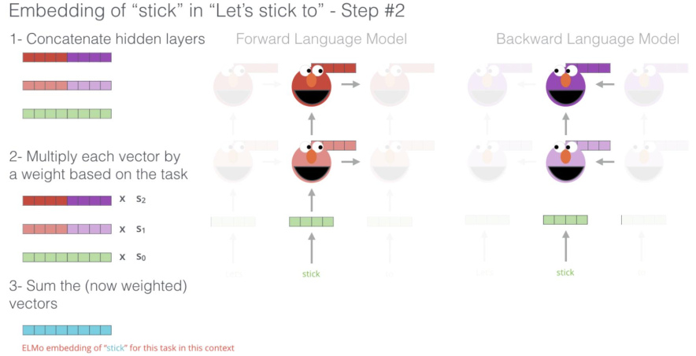

1. Embeddings from Language Models(ELMo)
- Bi-LSTM structure that processes context from both directions

2. significance
- first to use neural network output as embedding

reference:
- 가천대 인공지능입문 Lecture 5 강의 자료 