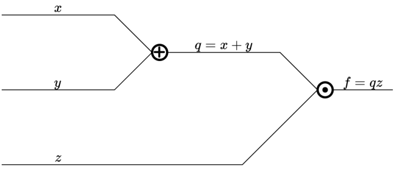
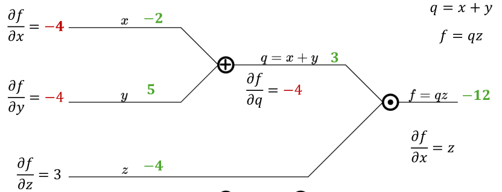
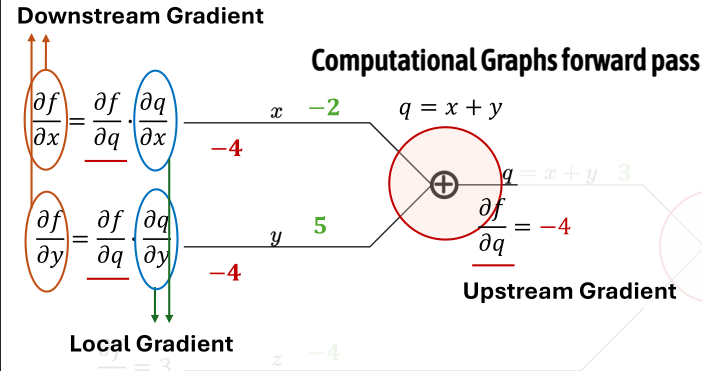
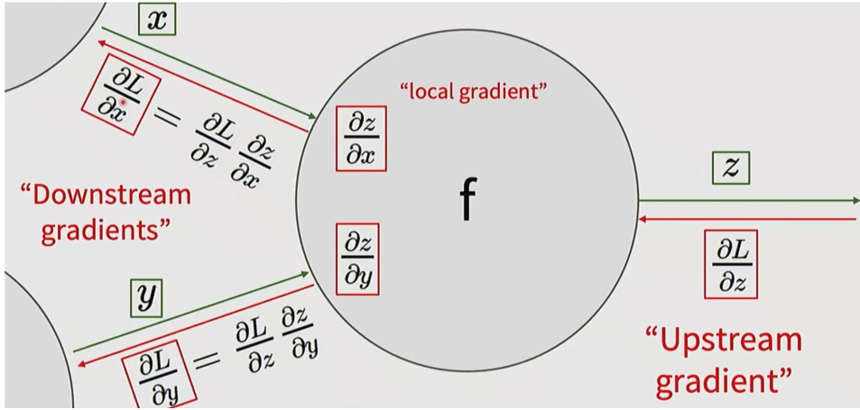

1. backpropagation
- efficient way to compute derivatives for neural network loss

2. simple example
- f(x,y,z) = (x+y)z
	
   - if x = -2, y = 5, z = -4
   - f(x,y,z) = -12
   - 𝜕𝑓/𝜕𝑧 = (x+y) = 3
   - where q = x+y, 𝜕𝑓/𝜕𝑦 = 𝜕𝑓/𝜕𝑞 * 𝜕𝑞/𝜕𝑦 = z*𝜕𝑞/𝜕𝑦 = z*1 = -4; f() is linearly sensitive to y, scaled by z
   - 𝜕𝑓/𝜕𝑥 = 𝜕𝑓/𝜕𝑞 * 𝜕𝑞/𝜕𝑥 = z*1 = -4; f() is linearly sensitive to x, scaled by z
	

3. upstream, local, and downstream gradients

