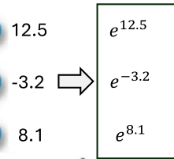
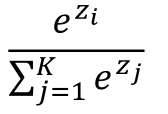

1. softmax
- transforms vector into probabilities
- used after final layer of neural network to get a vector of probabilities

2. steps
- make all positive with exponential function

- normalization
