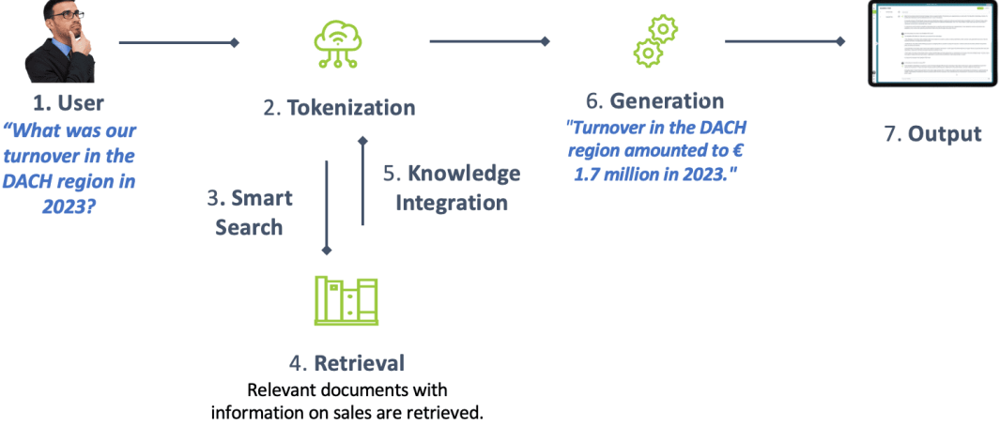

1. Retrieval Augmented Generation(RAG)
- instead of relying on own knowledge, retrieve data from external source and generate response based on it

2. process
2.1. retrieve: retrieve relevant data from data source
2.2. augment: combine query with retrieved data
2.3. generate: generate response based on new query

3. advantages
- can provide source of output
- no need to fine-tune model for each change, just need to modify DB

reference:
- 가천대 인공지능입문 Lecture 5 강의 자료 