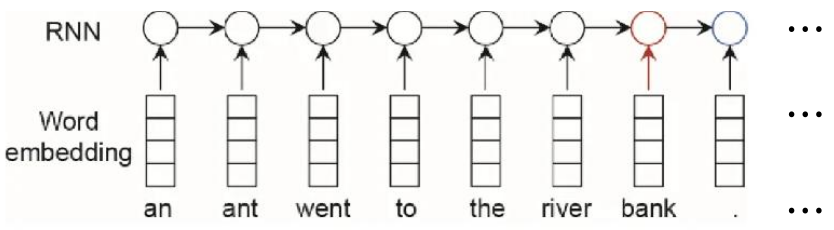
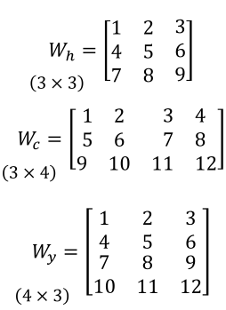
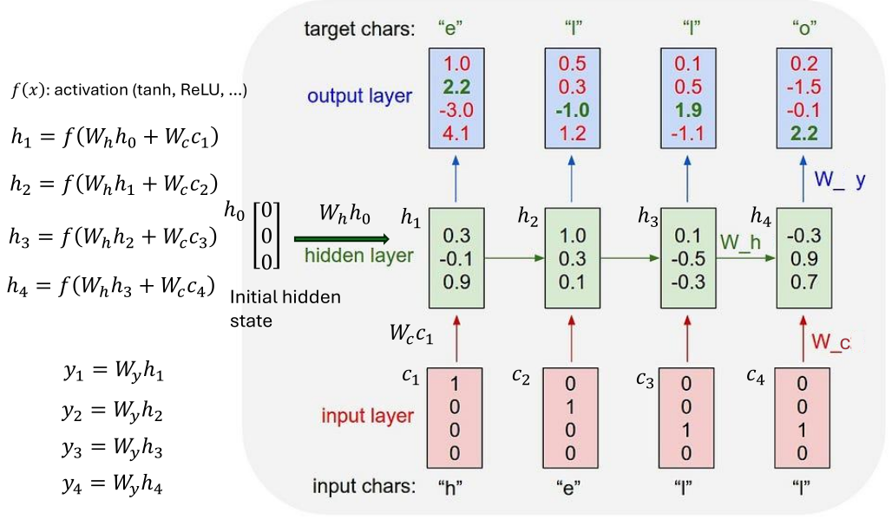

1. Recurrent Neural Network(RNN)
- input 1 token at a time to preserve order
- has hidden state as memory space; used to remember previous context

2. core concept - memory
- previous tokens are "remembered"

3. limits
- long-term dependency: as the sentence gets longer the first tokens "fade away" from memory
- performance: no parallelization

reference:
- 가천대 인공지능입문 Lecture 5 강의 자료 