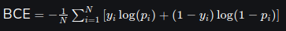

1. binary cross entropy
- loss function used in binary classification problems
- quantifies difference between the actual class labels and predicted probabilities output 

N: number of observations
yi: binary label of ith observation
pi: predicted probability of ith observation

2. how does binary cross entropy work
- measures distance between true labels and predicted probabilities
- when pi is close to yi, BCE is low
- when pi is not close to yi, BCE is high

reference:
<https://www.geeksforgeeks.org/binary-cross-entropy-log-loss-for-binary-classification/>