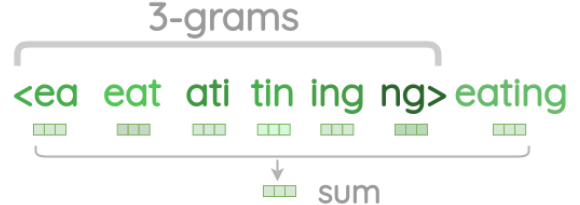

1. fastText 
- used to predict new words

2. process
- create n-grams from words
- train all embedding vectors for n-grams
- sum to create final embedding vector

3. advantages
- understands typos; e.g. appple
- understands new words; e.g. appletree

reference:
- 가천대 인공지능입문 Lecture 5 강의 자료 