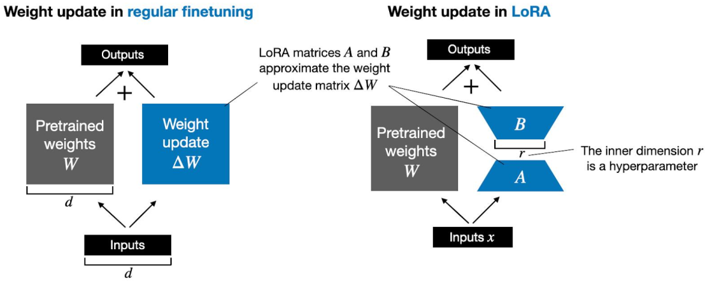
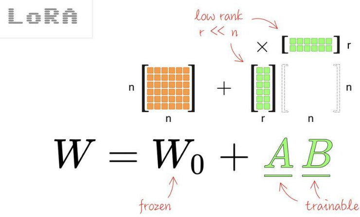
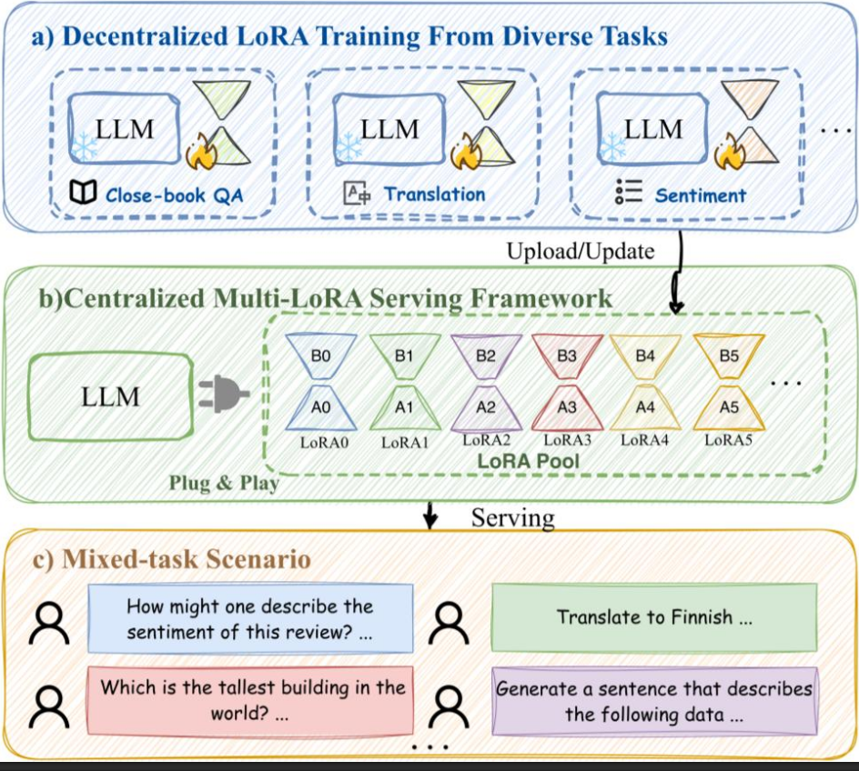

1. Low-Rank Adaptation(LoRA)
- instead of updating whole parameter matrix, store 2 small matrices that can be multiplied to approximate weight update matrix, ΔW

2. core concept - matrix factorization

3. advantages
- cost reduction: trainable parameters shrunk to about 1/10000
- performance retention: similar performance achieved
- modularization: parameters are only MB in size, easily switched 

reference:
- 가천대 인공지능입문 Lecture 5 강의 자료 