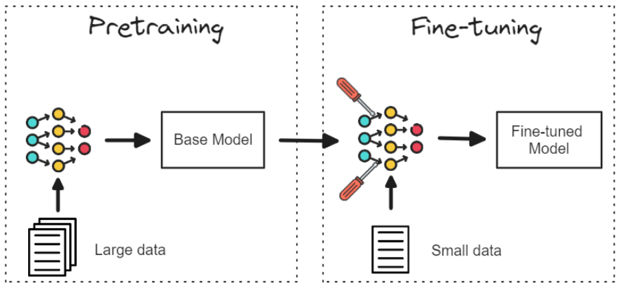
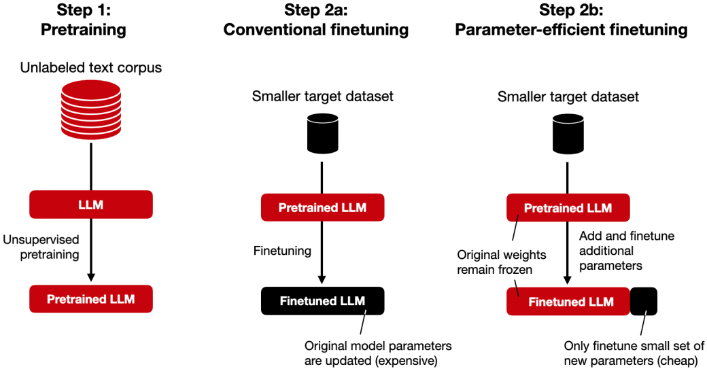

1. fine-tuning

- transforms generalist created after pre-training to specialist
- high performance despite low training cost

2. downstream tasks
- text classification
- Named Entity Recognition(NER)
- Question Answering(QA)
- summarization

3. Parameter Efficient Fine Tuning(PEFT)
- full fine-tuning requires separate management of multiple models
- freeze generalist model and only add a few core parameters
- LoRA is a widely used standard

reference:
- 가천대 인공지능입문 Lecture 5 강의 자료 