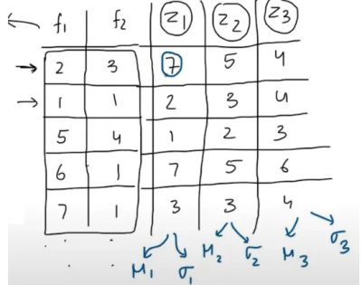
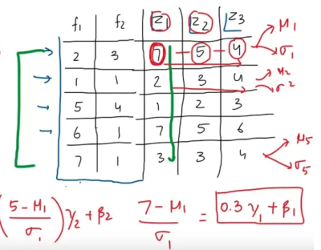

1. batch normalization vs layer normalization

batch normalization calculates mean and variance across batch

layer normalization calculates mean and variance across features

reference:
<https://medium.com/@sachinsoni600517/layer-normalization-in-transformer-1a2efbff8b85>