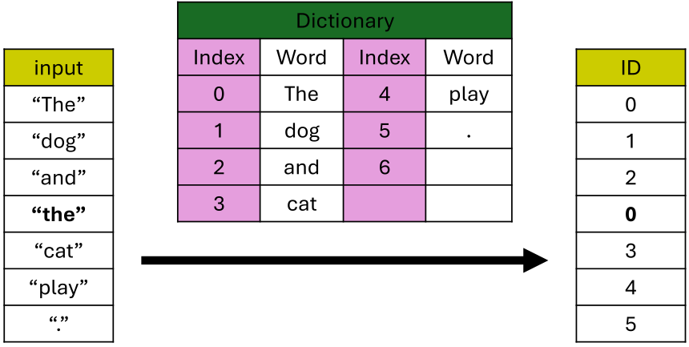

1. one-hot encoding
- create vector size of the dictionary and set corresponding index to 1, rest to 0

2. limits
- can't represent similarities between words
- inefficient with large dictionaries

reference:
- 가천대 인공지능입문 Lecture 5 강의 자료 