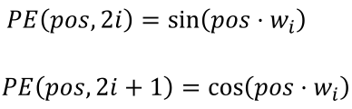
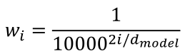
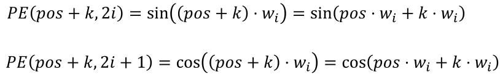
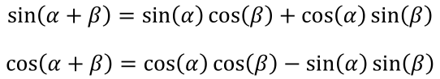
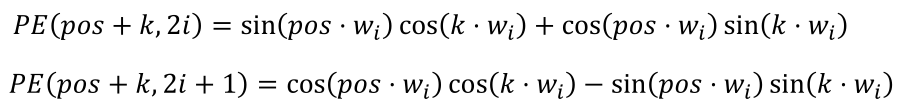
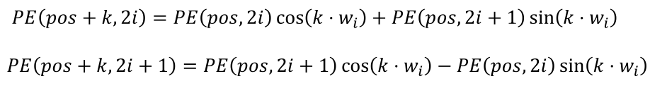
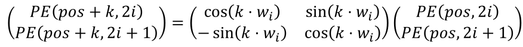

1. proof

where

using

we get

substituting values, 

we get 

which is a linear transformation of PE(pos, 2i)

2. meaning
- 2x2 matrix in the middle is a typical 2-dimensional rotation matrix
- no absolute value *pos* within rotation matrix, only relative distance and frequency w~i~
- consistent transformation no matter the position

reference:
- 가천대 인공지능입문 Lecture 5 강의 자료 