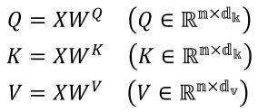
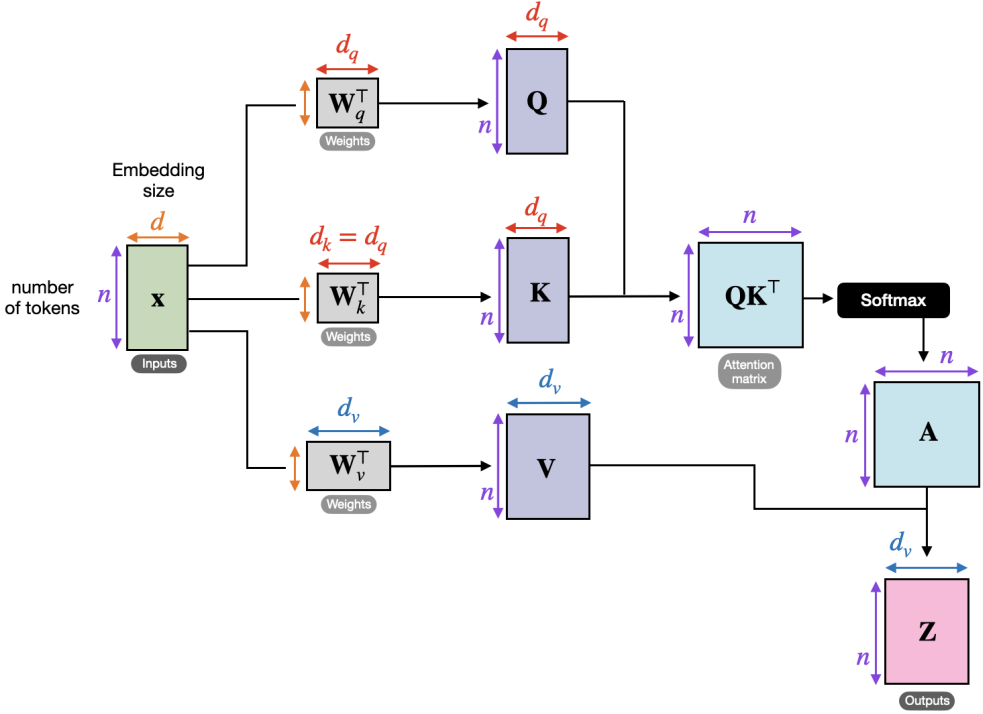

where X is the input sentence matrix

1. query vector
- linear transformation of input
- represents element of interest or context
- used to determine similarity or relevance
- means: "What am I looking for?"

2. key vector
- linear transformation of input
- used to compute how relevant each element in the input sequence is to the query
- means: "What feature do I have?"

3. value vector
- linear transformation of input
- stores actual information used to update representation of query
- means: "What does this word actually mean?"

4. process summary
- query vector ⋅ key vector for all key vectors => get relevancy between tokens
- divide each result vector by sqrt(d_k) => scale down 
- softmax on result vectors => get probability distribution
- multiply result by value vector => get value
- sum vectors to output vector
- (can use matrix multiplication instead. See [1] The Illustrated Transformer [2] attention is all you need)

reference:
- <https://rahulrajpvr7d.medium.com/what-are-the-query-key-and-value-vectors-5656b8ca5fa0>
- <https://h2o.ai/wiki/self-attention/>
- 가천대 인공지능입문 Lecture 5 강의 자료 