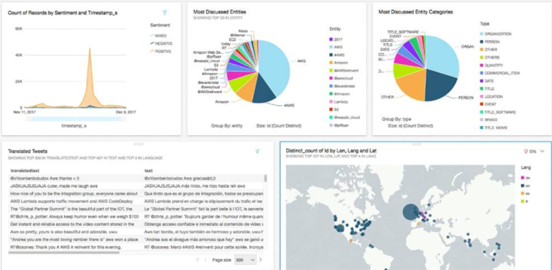
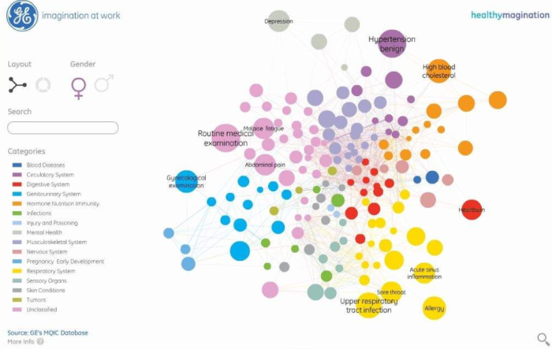

1. text analytics
- statistics and Natural Language Processing (NLP)
- word frequency distribution analysis
- text feature recognition
- pattern recognition
- entity-relationship extraction
- word co-occurrence analysis
- applications:
   - internet search
   - online ad placement
   - social media monitoring
   - sentiment analysis
   - spam filtering
   - machine translation
   - next word or word context prediction

2. text summarization
- extraction method:
   - KeyPhrase method: create tags by extracting words and phrases
   - document summarization method: extract sentences and assemble them
- abstraction method:
   - automatically create a summary document
   - more difficult than extraction method

3. text visualization
- gives top-level view of topics in corpora
- shows relationship between topics and objects in corpora
- shows highly structured nature of textual contents in simplified way
- shows main dimensions of high dimensional space of textual documents

4. text visualization techniques
- represent as bag-of-words and perform clustering to identify structure then map result to 2d or 3d space
- find frequent co-occurences of words and phrases and visualize as graph

reference:
- Gachon University - Machine learning lecture