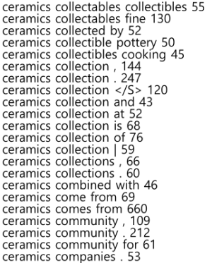
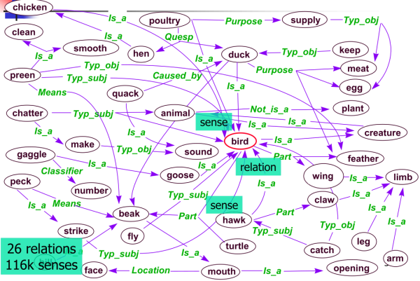

1. levels of text representations
- lexical analysis (tokenization):
   - character
   - words
   - phrases
   - part-of-speech tags
   - taxonomies/thesauri
- syntactic analysis:
   - vector-space module
   - language model
   - full-parsing
   - cross-modality
- semantic analysis:
   - collaborative tagging
   - templates/frames
   - ontologies/first order theories

2. lexical analysis
- character level:
   - consists of a sequence of characters
   - document is represented by a frequency distribution of sequences
- word level:
   - most common representation
   - doesn't work for some languages like Chinese with a different semantic unit
   - word relations:
      - homonym: same form, different meaning (bank: river bank, financial institution)
      - polysemy: same form, multiple meaning (bank: blood bank, financial institution)
      - synonym: different form, same meaning
      - hyponym: one word denotes subclass of another
   - word frequencies have power distribution (80/20 rule)
- phrase level:
   - phrases as frequent contiguous/non-contiguous word sequences
   - using phrases more precisely identifies sense
   - e.g. n-grams
	
- part-of-speech level:
   - introduces word types to differentiate word functions
   - mainly used to extract key information (nouns) or reduction of vocabulary
   - usually learned by Hidden Markov Model (HMM) on manually tagged data
- taxonomies/thesaurus level:
   - connect synonyms into one sense
   - connect hypernym to relate general-to-specific word senses
	

3. syntactic analysis
- vector-space model level:
   - transform documents into numeric vectors then apply linear algebra operations
   - forgets everything about linguistic structure (no order)
   - typical tasks are classification, clustering, visualization, etc
- language model level:
   - determine probability of a sequence of words
   - typically reduced to estimating probability of next word given two previous words (tri-gram model)
   - applications:
      - speech recognition
      - Optical Character Recognition (OCR)
      - handwriting recognition
      - machine translation
      - spelling correction
- full-parsing level:
   - parsing provides maximum structural information per sentence
   - usually too complex
- cross-modality level:
   - create mappings between different representations of objects (text, image, video, ...) and correlate them

reference:
- Gachon University - Machine learning lecture