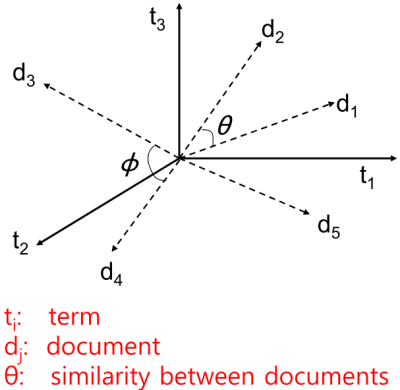
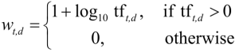
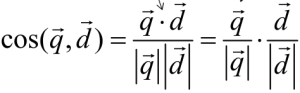
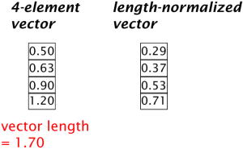
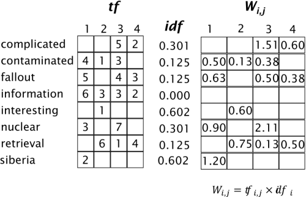
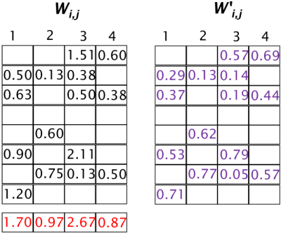
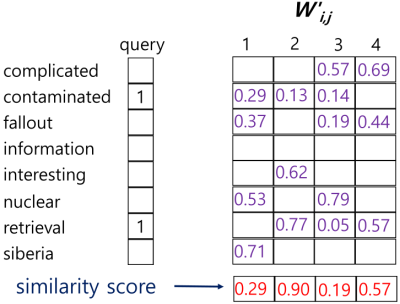

1. bag of words

- word order is not accounted for, only frequency
- can be represented as vectors
- elements:
   - Term Frequency (TF)
   - Document Frequency (DF)
   - query-document matching score

2. vector space model

- terms are axes of space
- documents are vectors in this space
- very high-dimensional
- very sparse (most entries are zero)

3. Term Frequency (TF)
- number of times a term appears in a document
- relevance does not increase proportionally with term frequency => use log

4. Inverse Document Frequency (IDF)
- based on idea that rare terms are more informative than frequent terms
- represents inverse of number of documents that contain the term
IDF~t~ = log~x~(N/df~t~)

5. tf-idf weighting
w~td~ = (1+log(tf~td~)*log(N/df~t~)
- w~td~: weight assigned to term t in document d
- tf~td~: number of term t in document d
- N: number of documents
- df~t~: number of documents with term t

6. query-document match
- represent queries as vectors in vector space
- rank documents according to proximity to query

7. cosine as proximity
- lower the angle, higher the cosine value

- cosine similarity can be used to measure proximity

8. normalizing vector length
- divide each component by vector's length (L2 norm)

9. tf-idf walkthrough
- calculate weight matrix

- normalize weight matrix

- match query with document

reference:
- Gachon University - Machine learning lecture