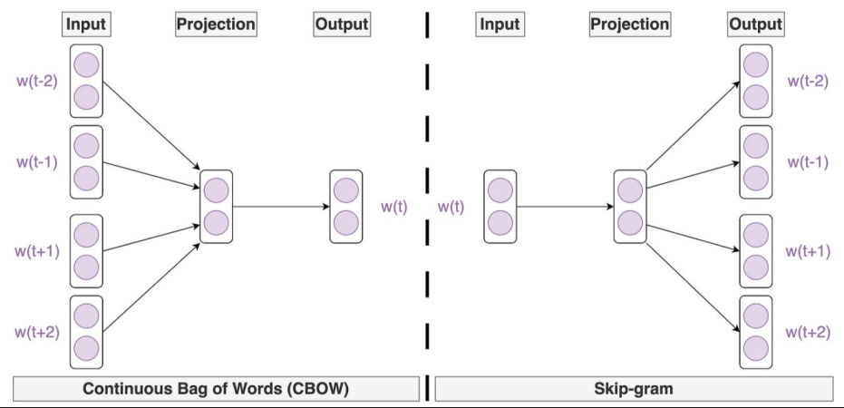
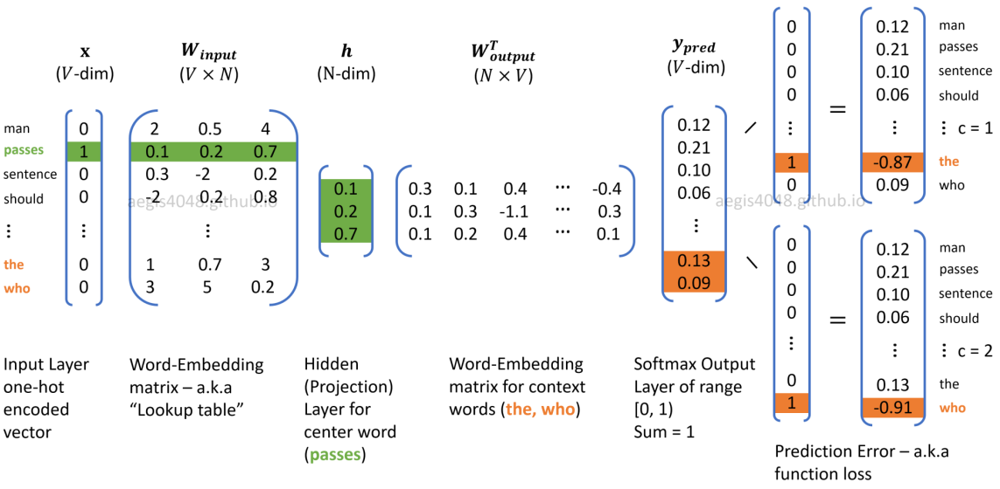

1. skipgram
- uses centre word to predict surrounding words

2. process
- one-hot encoding
- multiply one-hot input vector with W
- input result into hidden layer
- multiply hidden layer output with W'
- Softmax resulting vector
- compare vector with one-hot vectors of answer to get loss
- backpropagation and gradient descent to minimize loss

reference:
- 가천대 인공지능입문 Lecture 5 강의 자료 