1. word embeddings
- dense vector representations of text
- uses distributional hypothesis; words that appear in similar contexts have similar meaning
- captures word's meanings
- central technique in NLP
- methods for training:
   - Word2Vec
   - GloVe (Global Vectors for word representation)

2. GloVe
- focuses on creating word co-occurrence matrix over whole corpus
- embeddings relate to probabilities that two words appear together
- e.g.
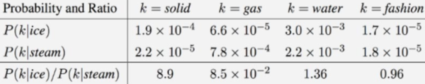

3. comparing word embeddings
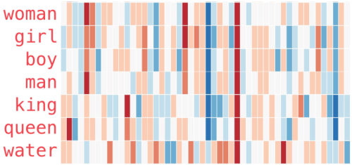
- related words have similar embeddings
- addition and subtraction can be done to word embeddings
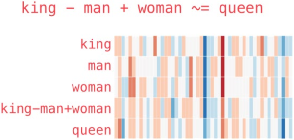

4. generating training dataset
- determine context window size n
- group words in window (context words) as sample

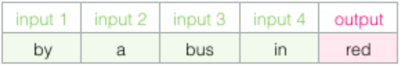

5. context word perspectives
- Continuous Bag of Words (CBoW):
   - given context words, predict target word
- SkipGram:
   - given target word, predict context words
	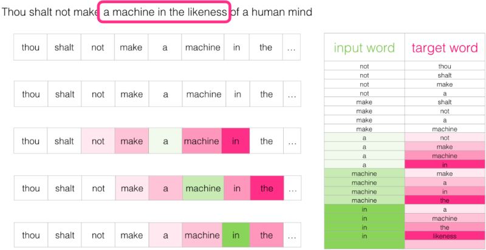

6. training model
- feed input word
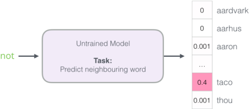
- get error vector
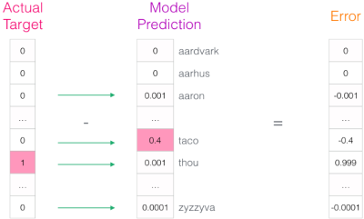
- update model parameters

7. speeding up training process - negative sampling
- to train embedding matrix, change "neighboring word prediction" task into "determine if two given words are neighbors or not" task:
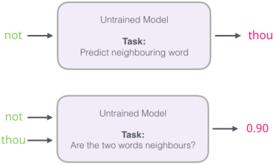
   - this changes the model from neural network to binary classifier, making it much more simple
   - requires dataset structure to be changed
	 => 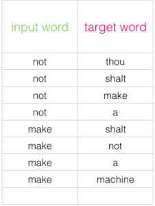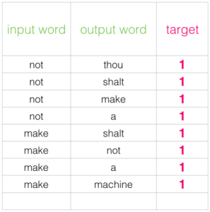
   - negative target values are required (chosen randomly from vocabulary)
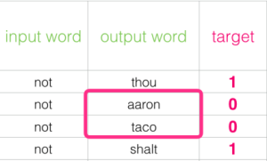

8. speeding up training process - hierarchical softmax
- use binary tree to store dictionary; reduces search time
- huffman tree; common words toward top of tree
- reduces computation time from linear to logarithmic time
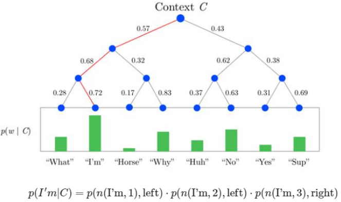

reference:
- Gachon University - Machine learning lecture
- 가천대 인공지능입문 Lecture 5 강의 자료 