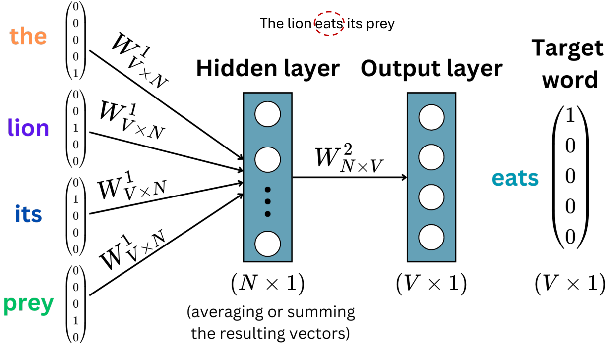
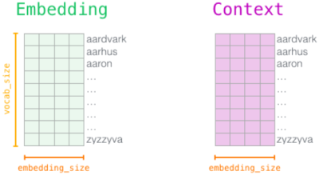
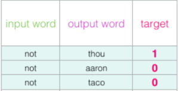
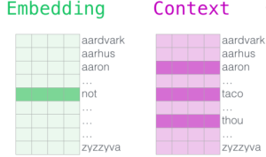
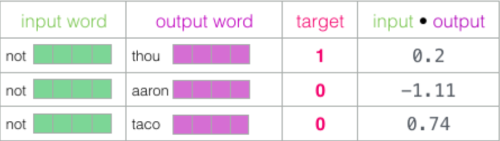
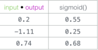
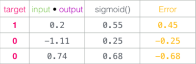

1. word2vec training process
- preprocess text corpus
- generate training dataset
- train embedding matrix
- train language model 
- detailed:
   - tokenize corpus
   - set hidden layer size (embedding dimension)
   - use sliding window to create dataset
   - one-hot encode all tokens
   - input one-hot vectors are multiplied with W
   - CBOW uses average of resulting vectors as input of hidden layer
   - output of hidden layer is multiplied with W' and put through Softmax
   - using resulting probability vector, get loss
   - backpropagation and gradient descent to train
   - discard W' and use W as word embedding matrix

2. train embedding matrix
- initialize embedding and context matrix with random values

- choose one positive sample and it's associated negative samples

- for input word, look up embedding in embedding matrix
- for context word, look up context matrix

- dot product input embedding with each context embedding to calculate similarity

- map values to 0~1

- subtract from target value to get error

- adjust embeddings to make errors smaller
- after multiple iterations and training finishes, discard context matrix

3. word2vec hyperparameters
- embedding size:
   - gpt-3 uses about 50000
- context window size:
   - 2~15: high similarity indicates interchangeable words
   - 15~50: high similarity indicates relatedness of words
   - 5 is default for Gensim
- number of negative samples:
   - 5~20 suggested

reference:
- Gachon University - Machine learning lecture
- 가천대 인공지능입문 Lecture 5 강의 자료 