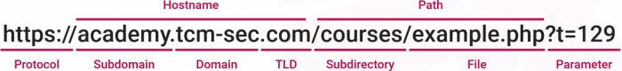
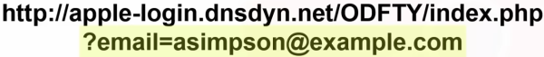
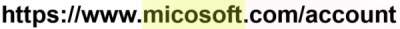

## 1. URL anatomy
1.1. normal URL

- domain + TLD can't be spoofed

1.2. suspicious URL
*always defang malicious URLs*

- use of http, not https
- actual domain is dnsdyn, not apple
- strange path name
- personal email as parameter

- typo squatting

2. URL analysis tools
- <https://defa.ng/>
   - defang malicious URLs
- <https://unshorten.net/>
   - unshorten URLs
- cyberchef
   - decode URLs
- email IOC extractor

reference:
- TCM-security SOC101: <https://youtu.be/56NDgBOSpUg?feature=shared>