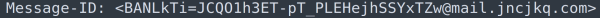
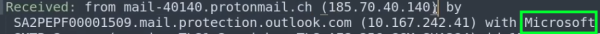
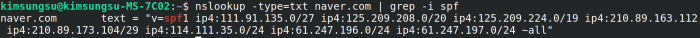

1. tools to use for email analysis
- sublime text
- thunderbird mail
- gmail

2. important headers
- date
   - email search and correlation
- from
   - can be spoofed => do not rely
- subject
   - find associated emails
- message-id
   - unique ID from first MTA traversed
   - contains domain name of host in which ID was created

- to
- reply-to
   - likely to be different from spoofed "from" header
- return-path
- X-sender-IP or X-originating-IP
   - certain MSAs don't add this
   - whois command on IP
   - reputation check on IP
- received
   - one for each MTA passed
   - reverse chronological order (top is recent)
   - should only trust received headers after it has been passed to an internal infrastructure or trusted domain

## 3. authentication
3.1. Sender Policy Framework (SPF)
- allows domain users to specify which mail servers are authorized to send emails on their behalf
- works by publishing SPF records in the DNS of a domain => list of authorized IP addresses
- can view with nslookup or dig

   - v=[version]
   - whitelisted ip addresses
   - include:[spf record to include]
   - -all: hard fail => reject not included
   - ~all: soft fail => accept but treat with caution

3.2. Domain Keys Identified Mail (DKIM)
- process:
   - sender identifies fields to include in signature
   - sender email platform creates hash of fields selected
   - hash is encrypted with private key
   - recipient email platform finds public key from sending domain DNS record
   - decrypt hash and compare with hash calculated from fields
- can:
   - authenticate origin of mails
   - verify integrity of content

3.3. Domain-based Message Authentication, Reporting, and Conformance (DMARC)
- allows domain owners to specify policies regarding how their emails are handled if SPF or DKIM checks fail
   - p=none: report only
   - p=quarantine: direct suspicious emails to spam folder
   - p=reject: reject email
- recipient's mail server admins can decide whether to honor DMARC policies set by sending domains

4. useful websites
- <https://mha.azurewebsites.net/>
   - email header analyzer

reference:
- TCM-security SOC101: <https://youtu.be/56NDgBOSpUg?feature=shared>
- proofpoint DKIM: <https://www.proofpoint.com/us/threat-reference/dkim>

further reading:
- DMARC: <https://dmarc.org/overview/>