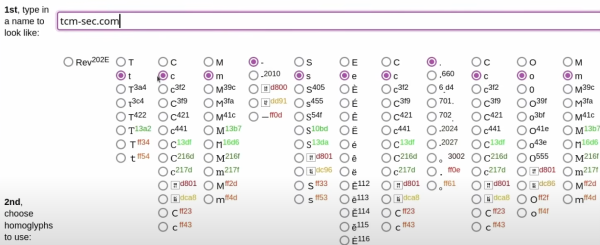
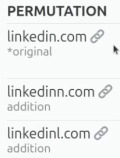

1. attack types
- information gathering
   - verify existing account
- credential harvesting
- malware delivery

2. attack techniques
- pretexting
   - manipulation under false pretense
- spoofing/impersonation
   - email address spoofing
   - domain spoofing
- URL manipulation
   - URL shortening
   - subdomain spoofing
      - e.g. noreply@google.xxx.com
   - homograph attacks

   - typosquatting

- attachments
- encoded malicious payload

3. analysis methodology
- initial triage
   - assess
   - prioritize
- header and sender examination
   - investigate MTA, IP, etc
   - check authenticity
- content examination
   - grammar error
   - awkward language
   - formatting
   - social engineering red flags
- web and URL examination
- attachment examination
- contextual examination
   - recent incidents
   - patterns
- documentation and reporting

reference:
- TCM-security SOC101: <https://youtu.be/56NDgBOSpUg?feature=shared>