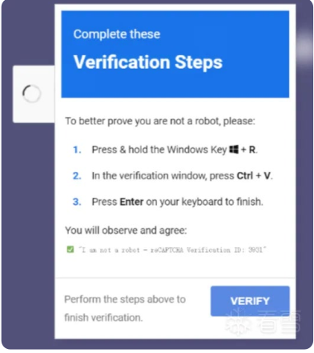

1. paste and run away 
- effective way to lure victims
- victim has to copy-paste and run code to fix access to a document or a video meeting
- employed via compromised websites posing as fake CAPTCHAs or page loading error

- payloads such as LummaC2 have been observed being delivered via this technique
- multi-layered execution chain delivering three or more payloads have also been observed

2. fake browser updates
- tricks users into downloading malicious executables posing as important browser updates
- employed by a number of threats:
   - SocGholish
   - Scarlet Goldfinch
   - FakeSG/Rogue Raticate

3. search engine optimization (SEO) poisoning
- adversaries create malicious websites that use SEO techniques like placing strategic keywords in the body or title of webpage to make it more prominent than legitimate websites 

4. malvertising
- use of fake ads on search engine pages 
- masquerades as legitimate websites 

5. phishing trends
- email phishing, QR code phishing, SMS phishing, and voice phishing all increased
- can become highly effective when paired with social engineering

6. vulnerability exploitation
- CVE-2024-1709 & CVE-2024-1708
   - ConnectWise ScreenConnect
- CVE-2023-48788
   - Fortinet Forticlient vulnerability

7. VPN abuse
- reporting on Akira and FOG emphasizes consistent targeting of VPN software, notably Cisco ASA, for initial access

8. prevention
- paste and run
   - user education
   - disallowing access to run dialog or even disabling use of cmd.exe and powershell.exe
- fake updates
   - educate users on legitimate update procedures
- SEO poisoning
   - update group policy object (GPO) settings to make scripts open in Notepad
- VPN exploitation
   - disable layer 2 visibility to VPN clients
   - improve visibility
- vulnerabilities
   - regular patch
   - maintain asset inventory 
   - be aware of surface area and what is exposed to the internet
