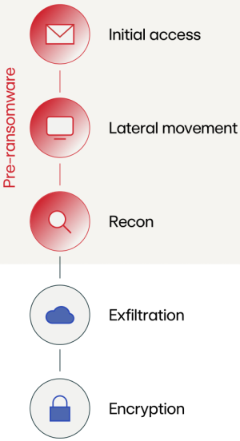

1. initial access
- vulnerabilities in ScreenConnect, Fortinet software abused
- Black Basta affiliates conducted social engineering campaigns 
   - email bombing to flood victim's inbox with spam
   - adversary posing as IT admin offers to help
   - guides user to run remote monitoring and management (RMM) tools
- VPN used as initial access vector 
   - conduct password spray attacks
   - Akira and FOG ransomware affiliates targeted VPN software

2. lateral movement
- continuous trend of adversaries moving quickly to unmonitored parts of the network
- often move to VMware ESXi hypervisors that are rarely monitored
   - encryptors usually stops all virtual machines running on a hypervisor before encrypting VMDK files
   - particularly valuable targets since they often host business-critical services
- many ransomware families like RansomHub, Play, Black Basta, and Akira include Linux variants that can be deployed against hypervisors
- prior to moving to ESXi environments, tools like Mimikatz are used to obtain credentials and PsExec or Impacket for lateral movement
- RMM tools have been observed being used to facilitate lateral movement and persist to act as a C&C server

3. reconnaissance
- built in commands are regularly used
   - ipconfig
   - whoami
   - net
   - nltest
- free open source tools may be used as well
   - AdFind
   - Angry IP Scanner
   - nmap
   - Bloodhound
   - PCHunter
   - Netscan

4. command and control
- adversaries continue to abuse RMM tools
   - offer robust admin features 
- common RMM tools:
   - NetSupport Manager
   - AnyDesk Standalone
   - TightVNC
   - ConnectWise

5. notable ransomware trends 
- social engineering tactics that include calling the victim has spread
- increase in email bombing followed by voice phishing 
- use of RMM tools increasing
- emergence of new ransomware variants during past year
- increase in ransom request amount 
- drop in total ransom earnings
- 2024 started off with operation Cronos as big win against ransomware operator LockBit

6. prevention
- patch known vulnerabilities
   - prioritize based on CISA's known exploited vulnerabilities catalog
- educate employees on latest ransomware actor TTPs
- disallow external access and allowlist partner domains on Microsoft Teams to prevent unauthorized access
- enhance endpoint visibility
- maintain approved tools list and monitor or deny unauthorized RMM tools