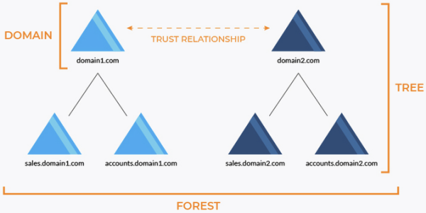

1. Active Directory (AD)
- directory service developed by Microsoft
- stores information about objects on network
- centrally manages objects
- uses various protocols:
   - LDAP: distribute computer/user data
   - Kerberos: authentication
   - DNS: resolve services to addresses
   - SMB/CIFS: file replication
   - RPC: various other functions

2. AD concepts
- object
   - something stored in AD
   - multiple types exist (e.g. user, computer, group, OU, etc)
   - each have a unique Security Identifier (SID)
- Organizational Unit (OU)
   - containers that can contain other objects
   - used to represent data logically
   - used to manage a collection of objects
- Domain Controller (DC)
   - server running Active Directory Domain Services (AD DS) role
   - authenticates/authorizes users and computers
   - assign/enforce security policies 
- schema
   - defines classes of objects, attributes, constraints, and name formats
- global catalog
   - contains information on every object in directory
   - used to find directory information 
- AD DS data store
   - referred to as the directory
   - contains information about objects
   - stored on domain controllers
   - contains NTDS.dit file and other database files
- domain
   - administrative boundary for applying policies to groups of objects
   - replication boundary for replicating data between DCs
   - authentication/authorization boundary that limits scope of access to resources
- tree
   - hierarchy of domains
   - can form forests

- trust
   - mechanism for accessing resources in other domains
- Group Policy Object (GPO)
   - predefined command/script for controlling policies
   - used to adjust settings for:
      - registry-based policies
      - security options
      - software installation
      - maintenance option

reference:
- Microsoft - Active Directory: <https://learn.microsoft.com/en-us/windows-server/identity/ad-ds/get-started/virtual-dc/active-directory-domain-services-overview>
- Microsoft - Directory data store: <https://learn.microsoft.com/en-us/previous-versions/windows/it-pro/windows-server-2003/cc736627(v=ws.10)>
- Wikipedia - Active Directory: <https://en.wikipedia.org/wiki/Active_Directory>
- TCM security - practical ethical hacking
- <https://www.reddit.com/r/techsupport/comments/ir4yf0/do_i_understand_active_directory_domain/>
- Varonis - group policy object: <https://www.varonis.com/blog/group-policy-objects>