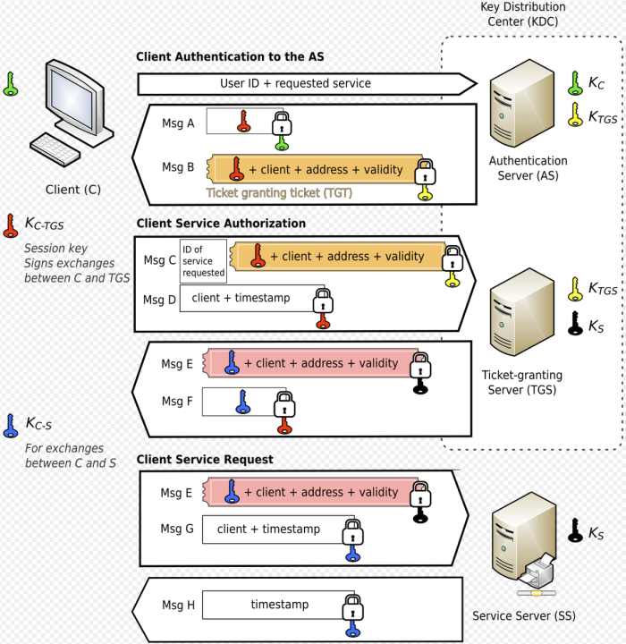

1. Client Authentication
- client sends plaintext message of user ID to AS (note: neither secret key nor password is sent)
- if client is in DB, generate secret key by hashing password of user and send back:
   - msg A: Client/TGS session key encrypted with secret key of user
   - msg B: TGT encrypted with secret key of TGS
- client decrypts session key with password from user (note: TGT cannot be decrypted)

2. Client Service Authorization
- client sends to TGS:
   - msg C: encrypted TGT and ID of requested service
   - msg D: authenticator (client ID and timestamp) encrypted with Client/TGS session key
- TGS decrypts TGT with it's secret key to get Client/TGS session key
- use session key to decrypt authenticator
- if client ID from msg D and msg C match, send:
   - msg E: client-to-server ticket encrypted with service's secret key
   - msg F: Client/Server session key encrypted with Client/TGS session key
- client decrypts msg F to obtain Client/Server session key

3. Client Service Request
- client sends to service:
   - msg E
   - msg G: new authenticator encrypted with Client/Server session key
- Server decrypts msg E to get Client/Server session key
- use session key to decrypt msg G
- if they match send to client:
   - msg H: timestamp found in authenticator encrypted with session key
- client decrypts msg H and checks if timestamp is correct
- client can trust server if timestamp matches

reference:
- wikipedia - Kerberos: <https://en.wikipedia.org/wiki/Kerberos_(protocol)#Description>