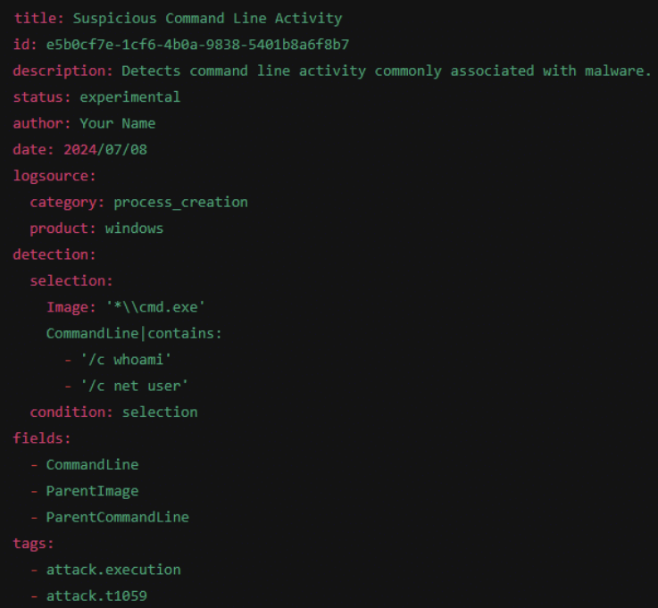

Sigma rules are YAML-written textual signatures designed to identify suspicious activity

## basic structure
1. header: metadata about the rule
2. log source: type of log data the rule applies to 
3. detection: conditions for the rule
4. fields: fields to be returned on match
5. tags: used for categorization

reference:
<https://cymulate.com/blog/cymulates-sigma-rules/>