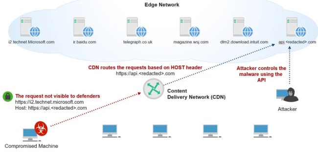

## 1. definition
the true destination of an HTTPS request is hidden by fronting the request with a TLS connection to a different domain

## 2. how
- TLS SNI extension domain name != HTTPS host domain name
- HTTPS domain name is not visible to firewall; seems like a legitimate connection
- CDN can route to domain name in HTTPS host

## 3. C&C use of domain fronting
2 requirements for C&C use:
- two-way read-write mechanism must be hosted by the CDN
- malware is specifically crafted for this channel

attacker commands =[API]=> server
command output =[API]=> server

reference (3.):
<https://www.cyberark.com/resources/threat-research-blog/implementing-malware-command-and-control-using-major-cdns-and-high-traffic-domains>

reference (all):
<https://www.zscaler.com/blogs/security-research/analysis-domain-fronting-technique-abuse-and-hiding-cdns>
<https://www.threatdown.com/blog/explained-domain-fronting/>
<https://digi.ninja/blog/domain_fronting.php>