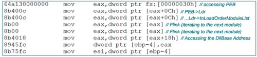

StealC contains the encrypted API functions within its code. After decrypting them, Ldr is used to load the functions

reference:
<https://metehan-bulut.medium.com/understanding-the-process-environment-block-peb-for-malware-analysis-26315453793f>