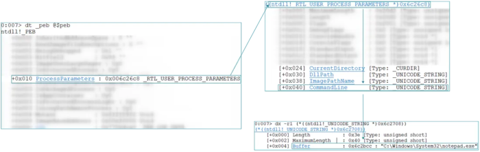

common uses: 
- executing the malware without arguments to discover the system, then creating a process with specialized command-line arguments
- evading EDR/IDS systems based on command-line argument strings

the common APIs are employed as so:
- NtQueryInformationProcess() to obtain PEB
- ReadProcessMemory() to read RTL_USER_PROCESS_PARAMETERS structure
- WriteProcessMemory() to write new command-line arguments

reference: 
<https://metehan-bulut.medium.com/understanding-the-process-environment-block-peb-for-malware-analysis-26315453793f>