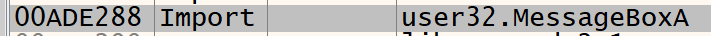
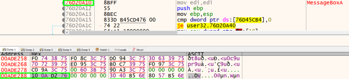
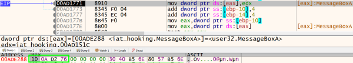
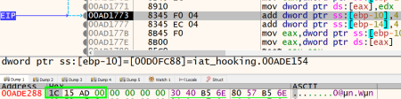
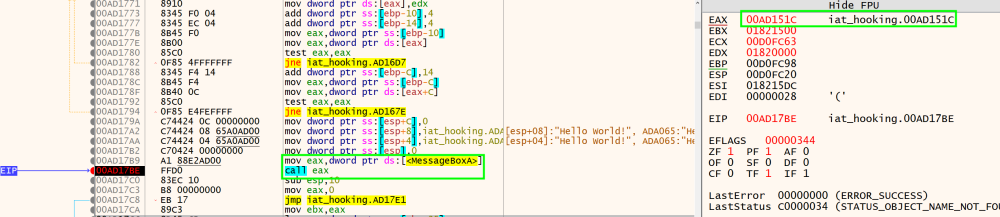
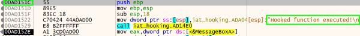
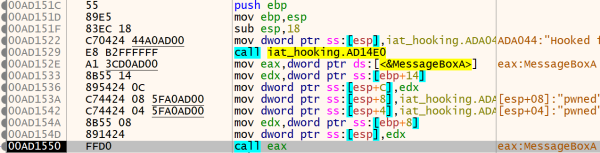
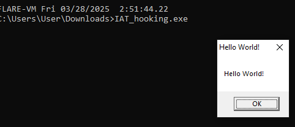
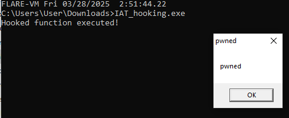

## 1. code
### 1.1. main

```cpp
MessageBoxA(NULL, "Hello World!", "Hello World!", 0); 
originalMsgBox = (PrototypeMessageBox)GetProcAddress(library_handle, "MessageBoxA");
```

save address of MessageBoxA


```cpp
IMAGE_DATA_DIRECTORY import_data_directory = nt_headers->OptionalHeader.DataDirectory[IMAGE_DIRECTORY_ENTRY_IMPORT];
import_descriptor = (PIMAGE_IMPORT_DESCRIPTOR)(import_data_directory.VirtualAddress + (BYTE*)image_base); // (DWORD_PTR)image_base
```

get pointer to the import data directory


```cpp
while(import_descriptor->Name != 0)
{
       library_name = (LPCSTR)(import_descriptor->Name + (BYTE*)image_base);
       library = LoadLibraryA(library_name);
(...)
       import_descriptor++;
}
```

loops through each imported library


```cpp
original_first_thunk = (PIMAGE_THUNK_DATA)(import_descriptor->OriginalFirstThunk + (BYTE*)image_base);
first_thunk = (PIMAGE_THUNK_DATA)(import_descriptor->FirstThunk + (BYTE*)image_base);
```

get original first thunk (RVA of ILT) and first thunk (RVA of IAT)


```cpp
while(original_first_thunk->u1.AddressOfData != 0)
{
(...)
       original_first_thunk++;
       first_thunk++;
}
```

loop through each entry in ILT


```cpp
if(std::string(function_name->Name).compare("MessageBoxA") == 0)
{
        DWORD old_protect = 0;
        VirtualProtect((LPVOID)(&first_thunk->u1.Function), 8, PAGE_READWRITE, &old_protect);
        first_thunk->u1.Function = (DWORD_PTR)hookedMessageBox;
}
```

overwrite with hook function if name matches

### 1.2. hookedMessageBox

```cpp
return originalMsgBox(hWnd, "pwned", "pwned", uType);
```

call MessageBoxA with different parameters

### 1.3. full code


```cpp
#include <windows.h>
#include <iostream>
#include <stdio.h>
#include <cstdint>

typedef int (WINAPI *PrototypeMessageBox)(HWND hWnd, LPCSTR lpText, LPCSTR lpCaption, UINT uType);

PrototypeMessageBox originalMsgBox;

int hookedMessageBox(HWND hWnd, LPCSTR lpText, LPCSTR lpCaption, UINT uType)
{
        printf("Hooked function executed!\n");
        return originalMsgBox(hWnd, "pwned", "pwned", uType);
}

int main()
{
        MessageBoxA(NULL, "Hello World!", "Hello World!", 0);

        HMODULE library_handle = LoadLibraryA("user32.dll");
        if(!library_handle)
        {
                std::cerr << "failed to load user32.dll\n";
                return 1;
        }
        originalMsgBox = (PrototypeMessageBox)GetProcAddress(library_handle, "MessageBoxA");
        if(!originalMsgBox)
        {
                std::cerr << "failed to get address of MessageBoxA\n";
                return 1;
        }

        LPVOID image_base = GetModuleHandleA(NULL);
        PIMAGE_DOS_HEADER dos_headers = (PIMAGE_DOS_HEADER)image_base;
        PIMAGE_NT_HEADERS nt_headers = (PIMAGE_NT_HEADERS)((DWORD_PTR)image_base + dos_headers->e_lfanew);

        PIMAGE_IMPORT_DESCRIPTOR import_descriptor = NULL;
        IMAGE_DATA_DIRECTORY import_data_directory = nt_headers->OptionalHeader.DataDirectory[IMAGE_DIRECTORY_ENTRY_IMPORT];
        import_descriptor = (PIMAGE_IMPORT_DESCRIPTOR)(import_data_directory.VirtualAddress + (BYTE*)image_base); // (DWORD_PTR)image_base

        LPCSTR library_name = NULL;
        HMODULE library = NULL;
        PIMAGE_IMPORT_BY_NAME function_name = NULL;

        while(import_descriptor->Name != 0)
        {
                library_name = (LPCSTR)(import_descriptor->Name + (BYTE*)image_base);
                library = LoadLibraryA(library_name);
                if(library)
                {
                        PIMAGE_THUNK_DATA original_first_thunk = NULL, first_thunk = NULL;
                        original_first_thunk = (PIMAGE_THUNK_DATA)(import_descriptor->OriginalFirstThunk + (BYTE*)image_base);
                        first_thunk = (PIMAGE_THUNK_DATA)(import_descriptor->FirstThunk + (BYTE*)image_base);

                        while(original_first_thunk->u1.AddressOfData != 0)
                        {
                                function_name = (PIMAGE_IMPORT_BY_NAME)(original_first_thunk->u1.AddressOfData + (BYTE*)image_base);

                                if(std::string(function_name->Name).compare("MessageBoxA") == 0)
                                {
                                        DWORD old_protect = 0;

                                        VirtualProtect((LPVOID)(&first_thunk->u1.Function), 8, PAGE_READWRITE, &old_protect);

                                        first_thunk->u1.Function = (DWORD_PTR)hookedMessageBox;
                                }

                                original_first_thunk++;
                                first_thunk++;
                        }
                }

                import_descriptor++;
        }

        MessageBoxA(NULL, "Hello World!", "Hello World!", 0);

        return 0;
}
```
## 2. demonstration


the address of MessageBoxA is stored at 00ADE288 in the IAT



the address inside 00ADE288 is changed



when MessageBoxA is called after IAT overwriting, it goes to our hook function


saved address of MessageBoxA can be called at the end of the hook function


reference:
<https://www.ired.team/offensive-security/code-injection-process-injection/import-adress-table-iat-hooking>