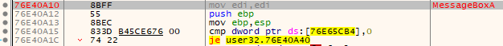
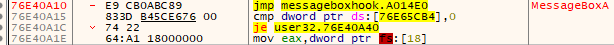
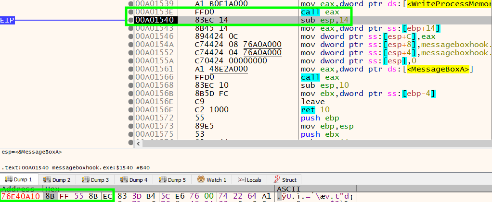
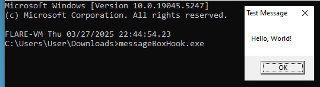
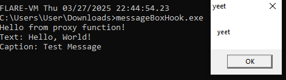

## 1. code
### 1.1. install_hook

```cpp
HINSTANCE library_handle = LoadLibraryA(TEXT("user32.dll"));
```

create handle of dll


```cpp
function_address = GetProcAddress(library_handle, "MessageBoxA");
```

get address of MessageBoxA


```cpp
ReadProcessMemory(GetCurrentProcess(), (LPVOID)function_address, saved_buffer, 5, NULL);
```

read first 5 bytes of MessageBoxA


```cpp
VOID *proxy_address = (VOID*)&proxy_function;
uintptr_t src = (uintptr_t)function_address;
uintptr_t dest = (uintptr_t)proxy_address;
DWORD relative_offset = (DWORD)(dest - src - 5);
```

calculate offset of proxy function from MessageBoxA


```cpp
memcpy(patch, "\xE9", 1);
memcpy(patch + 1, &relative_offset, 4);
WriteProcessMemory(GetCurrentProcess(), (LPVOID)function_address, patch, 5, NULL);
```

overwrite first 5 bytes

### 1.2. proxy_function

```cpp
WriteProcessMemory(GetCurrentProcess(), (LPVOID)function_address, saved_buffer, 5, NULL);
```

write original bytes back


```cpp
return MessageBoxA(NULL, "yeet", "yeet", uType);
```

call MessageBoxA

### 1.3. full code


```cpp
#include <windows.h>
#include <stdio.h>
#include <cstdint>

char saved_buffer[5];
FARPROC function_address;

int __stdcall proxy_function(HWND hWnd, LPCSTR lpText, LPCSTR lpCaption, UINT uType)
{
        printf("Hello from proxy function!\n");
        printf("Text: %s\nCaption: %s\n", lpText, lpCaption);

        WriteProcessMemory(GetCurrentProcess(), (LPVOID)function_address, saved_buffer, 5, NULL);

        return MessageBoxA(NULL, "yeet", "yeet", uType);
}

void install_hook()
{
        HINSTANCE library_handle = LoadLibraryA(TEXT("user32.dll"));
        function_address = GetProcAddress(library_handle, "MessageBoxA");

        char patch[5];
        ReadProcessMemory(GetCurrentProcess(), (LPVOID)function_address, saved_buffer, 5, NULL);

        VOID *proxy_address = (VOID*)&proxy_function;
        uintptr_t src = (uintptr_t)function_address;
        uintptr_t dest = (uintptr_t)proxy_address;
        DWORD relative_offset = (DWORD)(dest - src - 5);

        memcpy(patch, "\xE9", 1);
        memcpy(patch + 1, &relative_offset, 4);

        WriteProcessMemory(GetCurrentProcess(), (LPVOID)function_address, patch, 5, NULL);
}

int main()
{
        MessageBoxA(NULL, "Hello, World!", "Test Message", MB_OK);
        install_hook();
        MessageBoxA(NULL, "Hello, World!", "Test Message", MB_OK);
        return 0;
}
```
## 2. demonstration

MessageBoxA before install_hook


MessageBoxA after install_hook


MessageBoxA returned to normal in proxy_function




reference:
<https://medium.com/geekculture/basic-windows-api-hooking-acb8d275e9b8>