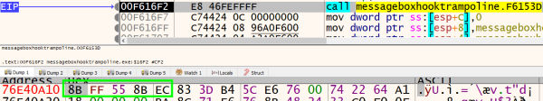
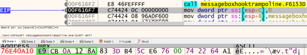
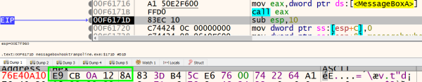
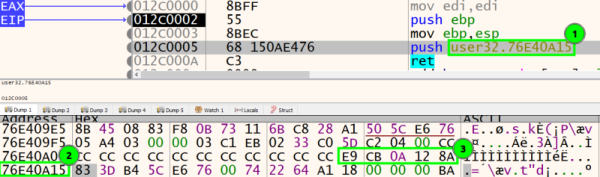
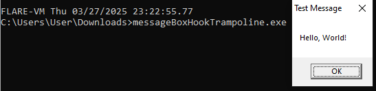
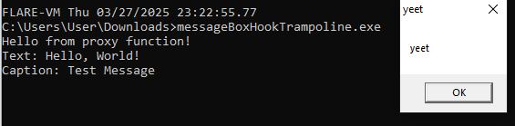
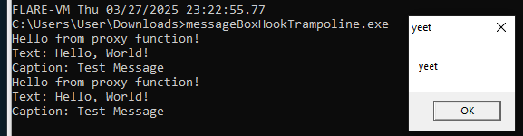

## 0. terminology
trampoline: a device that allows control to continue after the hook without removing the hook

## 1. code
### 1.1. install_hook

```cpp
trampoline_address = VirtualAlloc(NULL, 11, MEM_COMMIT, PAGE_EXECUTE_READWRITE);
uintptr_t hook_address = (uintptr_t)function_address + 5;
memcpy((BYTE*)trampoline_address, &saved_buffer, 5);
memcpy((BYTE*)trampoline_address + 5, "\x68", 1);
memcpy((BYTE*)trampoline_address + 6, &hook_address, 4);
memcpy((BYTE*)trampoline_address + 10, "\xC3", 1);
```

create trampoline

### 1.2. proxy_function

```cpp
defTrampolineFunc trampoline = (defTrampolineFunc)trampoline_address;
return trampoline(hWnd, "yeet", "yeet", uType);
```

go to trampoline

### 1.3. full code


```cpp
#include <windows.h>
#include <stdio.h>
#include <cstdint>

char saved_buffer[5];
FARPROC function_address;

typedef int (WINAPI *defTrampolineFunc)(HWND hWnd, LPCSTR lpText, LPCSTR lpCaption, UINT uType);
LPVOID trampoline_address;

int __stdcall proxy_function(HWND hWnd, LPCSTR lpText, LPCSTR lpCaption, UINT uType)
{
        printf("Hello from proxy function!\n");
        printf("Text: %s\nCaption: %s\n", lpText, lpCaption);

        defTrampolineFunc trampoline = (defTrampolineFunc)trampoline_address;
        return trampoline(hWnd, "yeet", "yeet", uType);
}

void install_hook()
{
        HINSTANCE library_handle = LoadLibraryA(TEXT("user32.dll"));
        function_address = GetProcAddress(library_handle, "MessageBoxA");

        char patch[5];
        ReadProcessMemory(GetCurrentProcess(), (LPVOID)function_address, saved_buffer, 5, NULL);

        VOID *proxy_address = (VOID*)&proxy_function;
        uintptr_t src = (uintptr_t)function_address;
        uintptr_t dest = (uintptr_t)proxy_address;
        uintptr_t relative_offset = (uintptr_t)(dest - src - 5);

        memcpy(patch, "\xE9", 1);
        memcpy(patch + 1, &relative_offset, 4);

        WriteProcessMemory(GetCurrentProcess(), (LPVOID)function_address, patch, 5, NULL);

        trampoline_address = VirtualAlloc(NULL, 11, MEM_COMMIT, PAGE_EXECUTE_READWRITE);
        uintptr_t hook_address = (uintptr_t)function_address + 5;
        memcpy((BYTE*)trampoline_address, &saved_buffer, 5);
        memcpy((BYTE*)trampoline_address + 5, "\x68", 1);
        memcpy((BYTE*)trampoline_address + 6, &hook_address, 4);
        memcpy((BYTE*)trampoline_address + 10, "\xC3", 1);
}

int main()
{
        MessageBoxA(NULL, "Hello, World!", "Test Message", MB_OK);
        install_hook();
        MessageBoxA(NULL, "Hello, World!", "Test Message", MB_OK);
        MessageBoxA(NULL, "Hello, World!", "Test Message", MB_OK);
        return 0;
}
```
## 2. demonstration

before hooking


after hooking


even after calling MessageBoxA, overwritten address remains


the trampoline can be seen in the disassembly.
the address at (1) is shown at (2). It is after (3) which is the first 5 bytes of MessageBoxA.




reference:
<https://medium.com/geekculture/basic-windows-api-hooking-acb8d275e9b8>