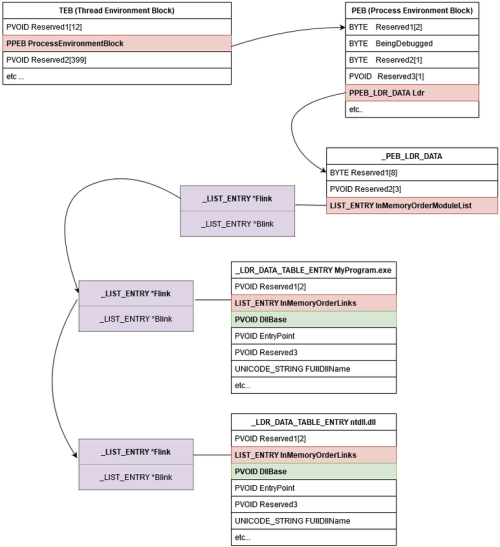

## 1. definition
executing code in the context of Windows APIs via system calls without obtaining them from Kernel32.dll or Ntdll.dll

## 2. why 
bypass EDR API hooking

## 3. steps
to use direct syscall:
- find base address of ntdll
- parse Export Address Table of DLL

### 3.1. retrieving ntdll address
TEB
=> PEB
=> PEB_LDR_DATA
=> _LIST_ENTRY

### 3.2. parsing EAT
- search AddressOfNames for function name
- get ordinal from AddressOfNameOrdinals
- get RVA from AddressOfFunctions

### 3.3. retrieve syscall ID
(1) Hell's Gate
- go to function address
- locate syscall stub

(2) Halo's Gate
- find function not hooked
- use difference between target and unhooked function to get syscall ID

(3) FreshyCalls
- sort functions by RVA

(4) Syswhispers2
- search for "Zw" not "Nt"

reference:
<https://redops.at/en/blog/direct-syscalls-a-journey-from-high-to-low>
<https://alice.climent-pommeret.red/posts/direct-syscalls-hells-halos-syswhispers2/>