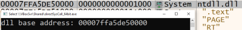
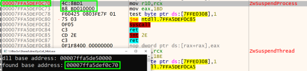
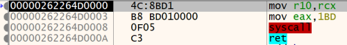

## 1. code
### 1.1. get dll base address

```cpp
PTEB teb_address = (PTEB)__readgsqword(0x30);
PPEB peb = teb_address->ProcessEnvironmentBlock;
PPEB_LDR_DATA ldr_data = peb->Ldr;
LIST_ENTRY list_entry_start = ldr_data->InMemoryOrderModuleList;
```

get list entries


```cpp
data_table_entry = (PLDR_DATA_TABLE_ENTRY)((BYTE*)current_list_entry - sizeof(PVOID)*2);
full_dll_name_unicode_string = data_table_entry->FullDllName;
base_dll_name_unicode_string = *(UNICODE_STRING*)((BYTE*)&(data_table_entry->FullDllName) + sizeof(UNICODE_STRING));
full_dll_name = full_dll_name_unicode_string.Buffer;
base_dll_name = base_dll_name_unicode_string.Buffer;
```

get dll name


```cpp
if(!wcscmp(target, base_dll_name))
{
    target_dll_base_address = data_table_entry->DllBase;
    break;
}

current_list_entry = current_list_entry->Flink;
```

if target dll is found, break out of loop

### 1.2. parse EAT

```cpp
PIMAGE_DOS_HEADER dos_header = (PIMAGE_DOS_HEADER)target_dll_base_address;
PIMAGE_NT_HEADERS64 nt_headers = (PIMAGE_NT_HEADERS64)(dos_header->e_lfanew + (BYTE*)target_dll_base_address);
PIMAGE_OPTIONAL_HEADER64 optional_header = &nt_headers->OptionalHeader;

PIMAGE_DATA_DIRECTORY export_data_directory =
    &optional_header->DataDirectory[IMAGE_DIRECTORY_ENTRY_EXPORT];

PIMAGE_EXPORT_DIRECTORY export_directory =
    (PIMAGE_EXPORT_DIRECTORY)(export_data_directory->VirtualAddress + (BYTE *)target_dll_base_address);

PVOID name_table = (PVOID)((DWORD64)export_directory->AddressOfNames + (DWORD64)target_dll_base_address);
```

find EAT of dll


```cpp
if(!strcmp((char *)current_name, TARGET_FUNCTION))
    break;

name_index++;
current_name = 
    (PVOID)(*(DWORD*)((DWORD64)name_table + sizeof(DWORD)*name_index) + 
    (DWORD64)target_dll_base_address);
```

find index of function name


```cpp
WORD ordinal = *(WORD*)((DWORD64)address_of_name_ordinals + sizeof(WORD)*name_index);
```

get ordinal of function name


```cpp
PVOID target_function_base_address = 
    (PVOID)(*(DWORD*)((DWORD64)address_of_functions + 
    sizeof(DWORD)*ordinal) + (DWORD64)target_dll_base_address);
```

get base of function

### 1.3. find syscall ID

```cpp
if(*(BYTE*)((DWORD64)target_function_base_address + offset) == 0x4c && 
    *(BYTE*)((DWORD64)target_function_base_address + offset + 1) == 0x8b &&
    *(BYTE*)((DWORD64)target_function_base_address + offset + 2) == 0xd1 &&
    *(BYTE*)((DWORD64)target_function_base_address + offset + 3) == 0xb8 &&
    *(BYTE*)((DWORD64)target_function_base_address + offset + 6) == 0x00 &&
    *(BYTE*)((DWORD64)target_function_base_address + offset + 7) == 0x00)
{
    syscall_number = *(BYTE*)((DWORD64)target_function_base_address + offset + 5) << 8;
    syscall_number += *(BYTE*)((DWORD64)target_function_base_address + offset + 4);
    break;
}
```

find syscall ID using stub

### 1.4. direct syscall

```cpp
BYTE byte_code[12] = "\x4c\x8b\xd1\xb8\x00\x00\x00\x00\x0f\x05\xc3";
byte_code[4] = (BYTE)(syscall_number);
byte_code[5] = (BYTE)(syscall_number >> 8);
void* syscall = VirtualAlloc(0, 11, MEM_COMMIT, PAGE_EXECUTE_READWRITE);
memcpy(syscall, byte_code, sizeof(byte_code));
((void(*)())syscall)();
```

syscall using ID

### 1.5. full code


```cpp
#include <intrin.h>
#include <stdio.h>
#include <windows.h>
#include <winnt.h>
#include <winternl.h>

#define TARGET_DLL L"ntdll.dll"
#define TARGET_FUNCTION "NtSuspendProcess"

int main()
{
        // get target dll base address
        PTEB teb_address = (PTEB)__readgsqword(0x30);

        PPEB peb = teb_address->ProcessEnvironmentBlock;
        PPEB_LDR_DATA ldr_data = peb->Ldr;
        LIST_ENTRY list_entry_start = ldr_data->InMemoryOrderModuleList;
        PLIST_ENTRY current_list_entry = list_entry_start.Flink;

        PWSTR full_dll_name = NULL, base_dll_name = NULL;
        UNICODE_STRING full_dll_name_unicode_string, base_dll_name_unicode_string;
        PLDR_DATA_TABLE_ENTRY data_table_entry = NULL;
        wchar_t target[] = TARGET_DLL;
        PVOID target_dll_base_address;

        while(current_list_entry != NULL)
        {
                data_table_entry = (PLDR_DATA_TABLE_ENTRY)((BYTE*)current_list_entry - sizeof(PVOID)*2);
                full_dll_name_unicode_string = data_table_entry->FullDllName;
                base_dll_name_unicode_string = *(UNICODE_STRING*)((BYTE*)&(data_table_entry->FullDllName) + sizeof(UNICODE_STRING));
                full_dll_name = full_dll_name_unicode_string.Buffer;
                base_dll_name = base_dll_name_unicode_string.Buffer;

                if(!wcscmp(target, base_dll_name))
                {
                        target_dll_base_address = data_table_entry->DllBase;
                        break;
                }

                current_list_entry = current_list_entry->Flink;
        }

        printf("dll base address: %p\n", target_dll_base_address);

        // parse EAT
        PIMAGE_DOS_HEADER dos_header = (PIMAGE_DOS_HEADER)target_dll_base_address;
        PIMAGE_NT_HEADERS64 nt_headers = (PIMAGE_NT_HEADERS64)(dos_header->e_lfanew + (BYTE*)target_dll_base_address);
        PIMAGE_OPTIONAL_HEADER64 optional_header = &nt_headers->OptionalHeader;

        PIMAGE_DATA_DIRECTORY export_data_directory =
                &optional_header->DataDirectory[IMAGE_DIRECTORY_ENTRY_EXPORT];

        PIMAGE_EXPORT_DIRECTORY export_directory =
                (PIMAGE_EXPORT_DIRECTORY)(export_data_directory->VirtualAddress +
                                                                  (BYTE *)target_dll_base_address);

        PVOID name_table = (PVOID)((DWORD64)export_directory->AddressOfNames + (DWORD64)target_dll_base_address);
        PVOID current_name = (PVOID)(*(DWORD*)name_table + (DWORD64)target_dll_base_address);
        int name_index = 0;
        while(current_name != NULL)
        {
                if(!strcmp((char *)current_name, TARGET_FUNCTION))
                        break;

                name_index++;
                current_name = (PVOID)(*(DWORD*)((DWORD64)name_table + sizeof(DWORD)*name_index) + (DWORD64)target_dll_base_address);
        }

        PVOID address_of_name_ordinals = (PVOID)((DWORD64)export_directory->AddressOfNameOrdinals + (DWORD64)target_dll_base_address);
        PVOID address_of_functions = (PVOID)((DWORD64)export_directory->AddressOfFunctions + (DWORD64)target_dll_base_address);
        WORD ordinal = *(WORD*)((DWORD64)address_of_name_ordinals + sizeof(WORD)*name_index);
        PVOID target_function_base_address = (PVOID)(*(DWORD*)((DWORD64)address_of_functions + sizeof(DWORD)*ordinal) + (DWORD64)target_dll_base_address);

        printf("found base address: %p\n", target_function_base_address);

        int offset = 0;
        WORD syscall_number = 0;
        while(1)
        {
                if(*(BYTE*)((DWORD64)target_function_base_address + offset) == 0x4c && 
                        *(BYTE*)((DWORD64)target_function_base_address + offset + 1) == 0x8b &&
                        *(BYTE*)((DWORD64)target_function_base_address + offset + 2) == 0xd1 &&
                        *(BYTE*)((DWORD64)target_function_base_address + offset + 3) == 0xb8 &&
                        *(BYTE*)((DWORD64)target_function_base_address + offset + 6) == 0x00 &&
                        *(BYTE*)((DWORD64)target_function_base_address + offset + 7) == 0x00)
                        {
                                syscall_number = *(BYTE*)((DWORD64)target_function_base_address + offset + 5) << 8;
                                syscall_number += *(BYTE*)((DWORD64)target_function_base_address + offset + 4);
                                break;
                        }
                offset++;
        }

        printf("syscall number: %d\n", syscall_number);

        BYTE byte_code[12] = "\x4c\x8b\xd1\xb8\x00\x00\x00\x00\x0f\x05\xc3";
        byte_code[4] = (BYTE)(syscall_number);
        byte_code[5] = (BYTE)(syscall_number >> 8);
        void* syscall = VirtualAlloc(0, 11, MEM_COMMIT, PAGE_EXECUTE_READWRITE);
        memcpy(syscall, byte_code, sizeof(byte_code));
        ((void(*)())syscall)();

        return 0;
}
```
## 2. demonstration

ntdll.dll base address found


base address of function found


direct system call from user heap