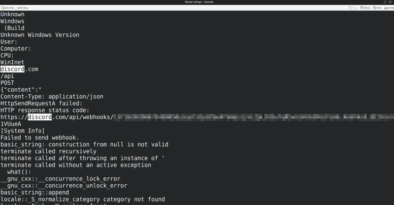

# 1. obfuscation techniques
## 1.1. stripping
stripping a binary removes:
- debug symbols
- symbol table entries
- relocation information (in some cases)
- section names
but not:
- exported function names
- imported function names

## 1.2. string encryption
encrypt or encode strings and decrypt them at runtime to avoid detection via static analysis

malicious text spotted easily via the strings command