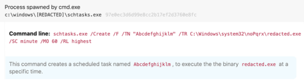
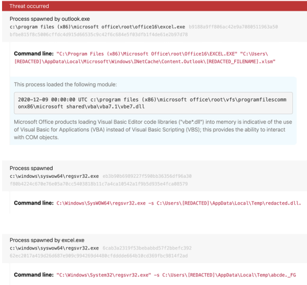
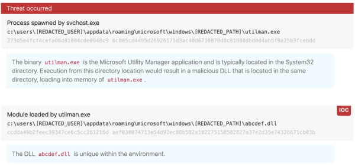

- banking trojan. 
- shares code similarities and overlapping infrastructure with Gameover Zeus
- consistently focused on getting into user mailboxes and ushering users into unwittingly executing malicious code
- in the most recent shift, delivers malicious excel documents leveraging the underlying Excel 4.0 macro (XLM) functionality

## Detection opportunities
### (1) Schedule task creation containing system directory
ATT&CK technique(s): T1053.005 Scheduled Task/Job: Scheduled Task
ATT&CK tactic(s): Persistence

Dridex maintains persistence via the creation of scheduled tasks within system directories. Identifying the instances of schtasks.exe where the command line contains both the flag /create and a system path helps identify Dridex

### (2) Excel spawning regsvr32.exe
ATT&CK technique(s): T1218.010 Signed Binary Proxy Execution: Regsvr32
ATT&CK tactic(s): Defense Evasion

files called regsvr32 traditionally end in .dll. Instances where excel.exe is spawning regsvr32.exe as a child is uncommon

### (3) DLL search order hijacking
ATT&CK technique(s): T1574.001 [Hijack Execution Flow: DLL Search Order Hijacking](https://redcanary.com/threat-detection-report/techniques/dll-search-order-hijacking/)
ATT&CK tactic(s): Persistence, Privilege Escalation, Defense Evasion

most easily identified when a native system binary is executed from a non-standard location

reference:
<https://redcanary.com/threat-detection-report/threats/dridex/>