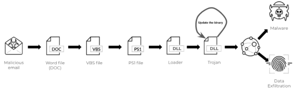

## 1. Attack chain analysis
steps:
(1) word doc distributed, opened with macros enabled
(2) VBScript macros run to generate malicious powershell script
(3) powershell script downloads the initial DLL binary as a loader
(4) initial loader drops a follow-up DLL binary that updates itself
(5) final DLL steals sensitive data or conducts further attacks communicating with C2 servers

## 2. Stages
### 2.1. First-stage malware: Word Macro Launcher
(sha256: 2cb81a1a59df4a4fd222fbcb946db3d653185c2e79cf4d3365b430b1988d485f)
this sample is a MS office OLE2 Compound File Binary Word file
(1) open file with macro
(2) execute deobfuscated payload

### 2.2. second-stage malware: powershell downloader
(1) display error message
(2) invoke powershell
	(2-1) set ServicePoint Manager security protocol to TSL 1.2.
	(2-2) 7 URIs generated =[download file]=> %USERPROFILE%\Ygyhlqt\Bx5jfmo\R43H.dll
	(2-3) execute downloaded dll

### 2.3. third-stage malware: DLL analysis
(sha256: bbb9c1b98ec307a5e84095cf491f7475964a698c90b48a9d43490a05b6ba0a79)
key: "k1>@dY0V<o)afFNz7v68r^Kn6)h)OGcSc"

(1) move R43H.dll => %SYSTEMROOT%\system32\<random_folder_name>\<random_filename>.<random_ext>
(2) resource data =[XOR decrypt]=> in-memory executable file
(3) install new service; automated malware execution

#### 2.4. fourth-stage malware: DLL analysis
(sha256: bd1e56637bd0fe213c2c58d6bd4e6e3693416ec2f90ea29f0c68a0b91815d91a)
(1) prepare environment to submit information to C2 server

### 2.5. fifth-stage malware: C2 traffic
(1) send data to C2 server

## 3. evasion technology
- multiple download links; higher chance of success
- multiple C2 server IP address; higher change of success
- standard HTTP with encrypted data; similar to benign traffic

reference (all):
<https://unit42.paloaltonetworks.com/emotet-command-and-control/>
<https://unit42.paloaltonetworks.com/attack-chain-overview-emotet-in-december-2020-and-january-2021/>