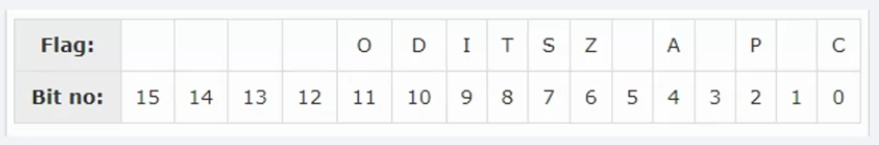
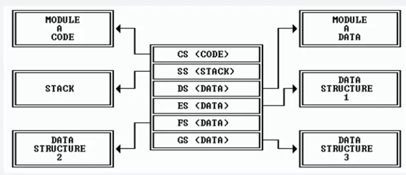

## (1) Data registers
- 32-bit registers:
- EAX: accumulator => I/O, arithmetic
- EBX: base => index addressing
- ECX: counter => loop count
- EDX: data => I/O
- lower half can be used as 16-bit registers:
- AX
- etc
- each 16-bit register can be divided into 2 8-bit registers, postfixed with H or L
- AH
- AL
- etc

## (2) Pointer registers
- EIP: instruction pointer => next instruction
- ESP: stack pointer => top of stack 
- EBP: base pointer => base of stack

## (3) Index registers
- ESI: source index => string operations
- EDI: destination index => string operations

## (4) Control registers
- EFLAGS

| flag | set to 1 | set to 0 |
| --- | --- | --- |
| SF | MSB of result is 1 | MSB of result is 0 |
| ZF | non-zero result | zero result |
| CF | carry out from MSB (addition) borrow into MSB (subtraction) | otherwise |
| AF | carry out from bit 3 (addition) borrow into bit 3 (subtraction) | otherwise |
| PF | low byte of result is even | otherwise |
| OF | signed overflow occurred | otherwise |

## (5) Segment registers
- CS: code segment
- DS: data segment
- SS: stack segment
- ES, FS, GS: for additional data

