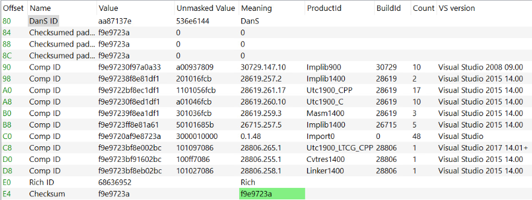

## Overview
- data between DOS stub and NT headers
- only present in executables built using the Microsoft Visual Studio toolset

## Structure

| name | meaning | size |
| --- | --- | --- |
| DanS ID | DanS | 4 bytes (DWORD) |
| padding | 0 | 12 bytes (3 DWORD) |
| comp ID | data entry | 8 bytes each |
| rich ID | Rich | 4 bytes (DWORD) |
| checksum | XOR key | 4 bytes (DWORD) |

reference:
<https://0xrick.github.io/win-internals/pe3/>