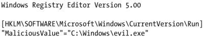

## 1. terms
- root key
the registry is divided into 5 top-level sections called root keys. Also called: HKEY, hive
- subkey
like a subfolder within a folder
- key
folder in the registry that can contain additional folders or values
- value entry
ordered pair with a name and value
- value
data stored in an entry

## 2. Root keys
- HKEY_LOCAL_MACHINE (HKLM)
- HKEY_CURRENT_USER (HKCU)
- HKEY_CLASSES_ROOT
stores information defining types
- HKEY_CURRENT_CONFIG
stores settings about current hardware configurations, specifically, differences with the standard configuration
- HKEY_USERS

## 3. Common registry functions
- RegOpenKeyEx
- RegSetValueEx
- RegGetValue

## 4. .reg
.reg files automatically merges information in the file with registry
