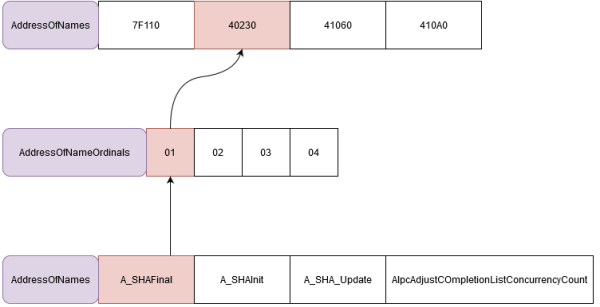

```c
typedef struct _IMAGE_EXPORT_DIRECTORY {              
    DWORD   Characteristics;            
    DWORD   TimeDateStamp;                
    WORD    MajorVersion;             
    WORD    MinorVersion;             
    DWORD   Name;                   // The name of the Dll
    DWORD   Base;                   // Number to add to the values found in AddressOfNameOrdinal to get real ordinal
    DWORD   NumberOfFunctions;      // Number of all exported functions
    DWORD   NumberOfNames;          // Number of functions exported by name
    DWORD   AddressOfFunctions;     // Export Address Table.
    DWORD   AddressOfNames;         // Export Name table.
    DWORD   AddressOfNameOrdinals;  // Export sequence number table.
} IMAGE_EXPORT_DIRECTORY, *PIMAGE_EXPORT_DIRECTORY;    
```

- AddressOfFunctions: use ordinal number as index to find RVA for function
- AddressOfNames: search for function names
- AddressOfNamesOrdinals: get ordinal number with index of function found in **AddressOfNames**


reference:
<https://alice.climent-pommeret.red/posts/direct-syscalls-hells-halos-syswhispers2/>