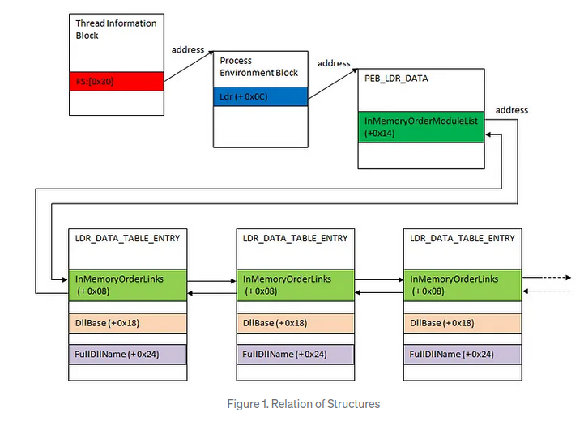

```cpp
typedef struct _PEB_LDR_DATA {
  BYTE       Reserved1[8];
  PVOID      Reserved2[3];
  LIST_ENTRY InMemoryOrderModuleList;
} PEB_LDR_DATA, *PPEB_LDR_DATA;
```




## See also
- [[PEB|Process Environment Block (PEB)]]

reference:
<https://learn.microsoft.com/en-us/windows/win32/api/winternl/ns-winternl-peb_ldr_data>
<https://sachiel-archangel.medium.com/how-to-analyze-dll-address-acquisition-process-593bc8a54988>