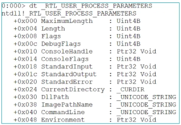

the ProcessParameters field points to the _RTL_USER_PROCESS_PARAMETERS structure. Significant fields are:
- CurrentDirectory (0x24)
- DllPath (0x30)
- ImagePathName (0x38)
- CommandLine (0x40)
- Environment (0x48)

this field can server several purposes, including VM detection and information-gathering

can be used for:
- Command Line Manipulation
- UAC Bypass