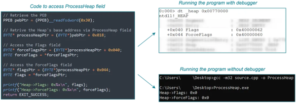

debugger usage on the program affects 2 fields of the heap called Flags and ForceFlags

These 2 flags are normally set to 0. If they aren't, the program is being debugged

further reading:
<https://anti-debug.checkpoint.com/techniques/debug-flags.html#manual-checks-heap-flags>