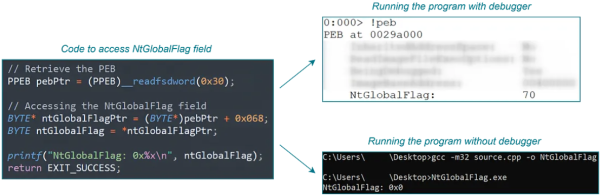

when a process is created with a debugger, the following global flags are set
- FLG_HEAP_ENABLE_TAIL_CHECK => 0x10
- FLG_HEAP_ENABLE_FREE_CHECK => 0x20
- FLG_HEAP_VALIDATE_PARAMETERS => 0x40

these flag settings result in NtGlobalFlag being set to 0x70

If a debugger is not attached, or attached after the process creation, these flags are not affected

