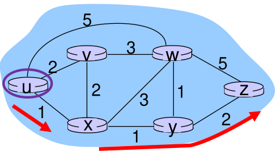

1. Distance Vector(DV)
- each router knows neighbor's information
- each router maintains DV
- DV exchanged with only neighboring routers; forwarding table updated to find better path
- eventually forwarding table converges
- iterative
- asynchronous
- distributed
- good news travels fast; cost change to lower propagates quickly
- bad news travels slow (count to infinity); cost change to higher propagates slowly

2. Bellman-Ford equation
- d~x~(y) := cost of least-cost path from x to y
- then, d~x~(y) = min~v~(c(x,v) + d~v~(y))

3. Bellman-Ford demonstration

- d~u~(z) = min(c(u,v)+d~v~(z), c(u,x)+d~x~(z), c(u,w)+d~w~(z))
= min(2+5, 1+3, 5+3)
= 4

4. DV algorithm
- D~x~(y) = estimate of least cost from x to y
- D~x~ = [ D~x~(y): y in N ]
- x knows cost to each direct neighbor: c(x,v)
- x maintains D~v~ = [ D~v~(y): y in N ]
- send DV estimate to neighbor occasionally
- upon receiving DV estimate, update DV using B-F equation

reference: 
- Gachon University Computer Network class material
- Computer Networking: A Top Down Approach 